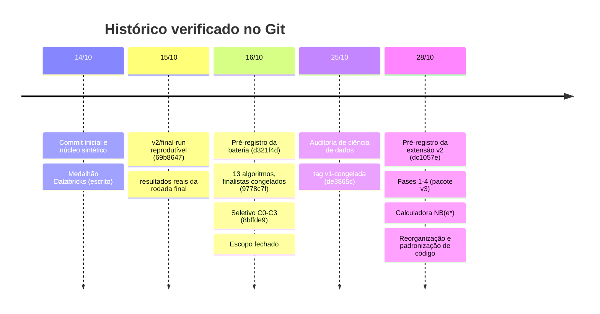
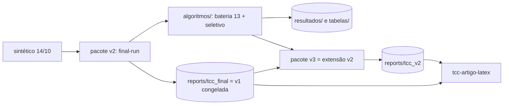

# Versões e experimentos

Mapa para não confundir o que "v1", "v2" e "v3" querem dizer. Fonte: histórico do Git (114 commits, 14 a 28/10/2026), `docs/V2_PREREGISTRO.md`, `docs/ESTADO_PROJETO.md` e os diretórios de resultados. Onde não verifiquei, está escrito.

## 1. Quatro dimensões independentes

| Dimensão | O que é | Valor atual |
|---|---|---|
| Versão de software | Release técnica do código | `tcc-frota 0.1.0` (`pyproject.toml`); não há tag de release do software |
| Versão experimental | Protocolo e algoritmos de uma campanha | v1 (artigo), bateria, seletivo, **extensão v2** (ver §2) |
| Versão dos resultados | Resultados congelados ligados a um pré-registro | `v1-congelada` (tag, commit `de3865c`; 19 hashes) e `reports/tcc_v2/` |
| Versão do documento | Texto da tese/artigo | `tcc-artigo-latex/` (repositório próprio, `main`, último commit `6ff6490`) |

## 2. Armadilha de nomes: “v2” × “v3”

| Nome | Onde aparece | Significa |
|---|---|---|
| **v2** (pacote `src/tcc_frota/v2/`) | código | a **rodada final do artigo** (a “v1” dos documentos): lotes, regras, Silver/Gold, simulador, políticas, `final-run` |
| **v1** (documentos, tag `v1-congelada`) | docs, hashes | os **resultados** produzidos por esse código; `reports/tcc_final/` |
| **v3** (pacote `src/tcc_frota/v3/`, scripts `v3_*.py`) | código | a **extensão v2 do TCC** (documentos): inferência robusta, controles, oráculo, baselines B0–B4 |
| **extensão v2** (documentos, `reports/tcc_v2/`) | docs | o mesmo que o pacote `v3` |

Os nomes foram mantidos porque comandos, scripts, hashes e o pré-registro os citam. Renomear exigiria um commit científico separado.

## 3. Campanhas

| Campanha | Estado | Código | Scripts / comandos | Resultados | Texto |
|---|---|---|---|---|---|
| Experimento sintético original (14/10) | HISTÓRICO | `experiment.py`, `synthetic/`, `simulation/engine.py`, `optimization/greedy.py` | `tcc-frota run-synthetic` | `reports/examples/` | `docs/resultados.md` |
| Real legado, set/2026 (Gold Databricks) | HISTÓRICO (DT011–012) | `gold/` | `tcc-frota gold-export`, `gold-replay` | `reports/tcc_final/legado_setembro2026/` | `docs/experimento_real.md` |
| **Rodada final (v1 dos documentos)**, 15/10 | **CONGELADA** | `v2/` | `tcc-frota prepare-raw`, `final-run` | `reports/tcc_final/` (tab01–18, figuras) | `docs/resultados_reais.md` |
| Escopo fechado: demanda, pickup, equilíbrio (16/10) | EXECUTADA, exploratória | `analise/` | `scripts/rodar_demanda.py`, `rodar_pickup.py` | `resultados/demanda`, `pickup`, `equilibrio`; `tabelas/` | `docs/ESCOPO_FECHADO.md` |
| **Bateria de 13 algoritmos** (16/10) | **CONGELADA** (finalistas `9778c7f`) | `algoritmos/` | `scripts/bateria_algoritmos.ps1`, `python -m tcc_frota.algoritmos.cli` | `resultados/` | `docs/BATERIA_ALGORITMOS.md` |
| Guloso seletivo C0–C3 (16/10) | CONGELADA (`8bffde9`) | `algoritmos/guloso_seletivo.py`, `seletivo.py` | `scripts/guloso_seletivo.ps1` | `resultados/seletivo/` | `docs/RESULTADO_SELETIVO.md` |
| Disponibilidade operacional | EXPLORATÓRIA | `availability/` | `tcc-frota-disponibilidade …` | `reports/runs/` (ignorado) | `docs/disponibilidade.md` |
| **Extensão v2 (pacote `v3`)**, 28/10, Fases 0–4 | **ATUAL** | `v3/` | `scripts/v3_fase1.py` … `v3_fase4*.py`, `v3_decisao.py`, `v3_mde_nb.py` | `reports/tcc_v2/` | `reports/tcc_v2/RELATORIO_V2.md` |
| Extensão v2, fases 5 e 6 | NÃO FEITAS | — | — | — | memória do projeto |
| Simulador legado `simulation/engine.py` | SUPERADO pelo `v2/sim.py` (mantido; usado pelo sintético) | — | — | — | `v2/sim.py` docstring |

Estados: CONGELADA = coberta por hash/commit e não deve ser regerada no lugar; ATUAL = em uso, pré-registrada; HISTÓRICA/EXPLORATÓRIA = registro do percurso. **NÃO VERIFICADO** em todas as linhas que dependem de dados reais: nesta fase não foram reexecutadas (`data/raw/` ausente).

## 4. Linha do tempo

## 5. Reprodução (comandos)

Sem dados reais: `python -m pytest`; `python scripts/validar_baseline.py --out <json>`; `python scripts/verificar_repositorio.py`. Com `data/raw/` e autorização: ver `docs/GUIA_EXPERIMENTOS.md`. **Nunca** publicar no lugar dos diretórios congelados.

## 6. Limitações

Pré-registro com carimbo apenas do Git local; D1/D2 foram pedidos após ver a Fase 1 (sem mudar decisão); nomes “v2/v3” ambíguos (§2); a extensão não cobre as fases 5 e 6; resultados reais não reexecutados nesta fase.
