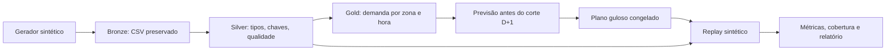

# Arquitetura implementada

O pacote `src/tcc_frota/` contém o núcleo Python independente de Databricks. `databricks/notebooks/` contém apenas perfil e auditoria agregada do Parquet autorizado em PySpark. O adaptador Elasticsearch local acrescenta Bronze por referência ao JSONL original, Silver documental/tipada e Gold temporal/agregado, documentados em [elasticsearch_local.md](elasticsearch_local.md). A demanda Gold depende de criação validada; o plano e a simulação reais continuam bloqueados. A matriz de regras e o registro de decisões são mantidos localmente, fora do Git; consulte essas fontes autorizadas antes de adaptar o experimento a dados reais.

A frente local de disponibilidade lê os nove CSVs atualmente presentes, com contratos para futuros Parquets, e reconstrói corridas/status em `src/tcc_frota/availability/`. Consulte [disponibilidade.md](disponibilidade.md). Ela ainda não alimenta a alocação gulosa porque não há probabilidade de disponibilidade e região validadas.

| Camada | Local | Databricks preparado | Semântica |
|---|---|---|---|
| Bronze | `ingestion/pipeline.py` exporta CSV sintético e hashes para teste local | não implementado para Parquet real | origem preservada em Volume autorizado |
| Silver | conversão segura e exclusões agregadas no ensaio local | não implementado para Parquet real | exige semântica de timestamps e disponibilidade |
| Gold | contagem sintética por zona/hora/split no ensaio local | não implementado para Parquet real | depende dos gates científicos |

O ensaio local é testado. Os notebooks Parquet não foram executados em workspace; permissões, catálogo e servidor devem ser confirmados na Free Edition. O adaptador sintético antigo permanece no código local como referência histórica, sem notebooks de execução. Dados reais ou volume maior exigem agregação e desenho adicional em Spark. Não há conexão a banco, API Sigma ou upload automático.

O motor de eventos aceita compromissos de outras modalidades como bloqueios de capacidade. O plano é feito antes do período de teste; solicitações futuras entram somente no replay. Relatório público contém agregados e zonas, não registros reais individualizados.
