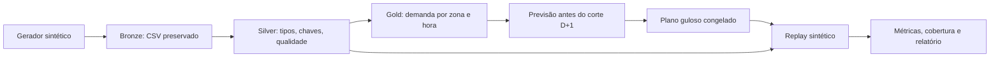

# Arquitetura implementada

O pacote `src/tcc_frota/` contém o núcleo Python independente de Databricks. `databricks/notebooks/` usa PySpark/Delta somente como adaptador. A matriz de regras e o registro de decisões são mantidos localmente, fora do Git; consulte essas fontes autorizadas antes de adaptar o experimento a dados reais.

| Camada | Local | Databricks preparado | Semântica |
|---|---|---|---|
| Bronze | `ingestion/pipeline.py` exporta CSV sintético e hashes | `02_bronze.py` persiste Delta por `run_id` | preserva fonte sintética |
| Silver | conversão segura e exclusões agregadas | `03_silver.py` valida tipos/coordenadas e rejeita IDs duplicados | entidades sintéticas, sem inferir regras empresariais |
| Gold | contagem por zona/hora/split | `04_eda.py` e `05`–`07` | demanda, previsão, plano e métricas |

O local é testado. As tabelas Delta e os notebooks não foram executados em workspace; permissões, catálogo e servidor devem ser confirmados na Free Edition. A coleta de Silver para o núcleo é limitada a 10 mil linhas sintéticas; dados reais ou volume maior exigiriam agregação e desenho adicional em Spark. Não há conexão a banco, API Sigma ou envio de CSVs reais.

O motor de eventos aceita compromissos de outras modalidades como bloqueios de capacidade. O plano é feito antes do período de teste; solicitações futuras entram somente no replay. Relatório público contém agregados e zonas, não registros reais individualizados.
