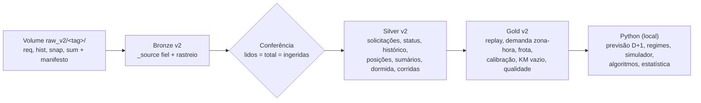

# Medalhão no Databricks (v2): Bronze, Silver e Gold

**Atualizado em 16/10/2026.** Esta página descreve o medalhão v2, construído sobre os extratos paginados do Elasticsearch de jan–mar/2026 e jul–set/2026. As tabelas legadas (out/2025–set/2026, DT010) foram apagadas em 15/10/2026, após backup e confirmação escrita do proponente. A Gold legada continua em `cat_mobilidade_urbana_gold.db_frota_legado` (DEEP CLONE) e em `reports/runs/gold_cache/`; o inventário antes e depois está em `reports/tcc_final/inventario_databricks_*.md`.

Previsão, algoritmos e simulação **não** rodam no Databricks. O núcleo Python (`src/tcc_frota/v2/`) implementa as mesmas regras de limpeza e reproduz a Gold localmente a partir dos extratos. Assim, `tcc-frota final-run` funciona sem o workspace. A conferência cruzada deu contagens idênticas em todas as tabelas e o mesmo conjunto de pseudônimos (288 motoristas).



## Entrada

Lotes em `data/raw/` (ignorado pelo Git), um por `--tag` do `extrair.js`: `mar2026`, `historico56` (04/01–28/02/2026), `set2026` e `historico56_set` (07/07–31/08/2026). `tcc-frota prepare-raw` descobre os lotes pelos `manifest_<tag>.json` e aceita pasta duplicada (`dados_x/dados_x/`) e nomes com barra invertida. Um lote só entra se `lidos == total` em todas as fases e se todos os arquivos listados existem. O comando lista os lotes encontrados, aceitos e rejeitados e falha se faltar algum dos quatro. Os mesmos arquivos foram copiados para `/Volumes/cat_mobilidade_urbana_bronze/db_frota/raw_v2/<tag>/` com autorização escrita do proponente (15/10/2026).

## Notebooks e execução

Formato fonte do Databricks (`.py` com `# COMMAND ----------`), um por tabela. Todos incluem `databricks/catalog/nb_v2_comum.py` por `%run`, que concentra constantes, leitura paginada com esquema explícito, tabela de status e pseudonimização.

| Camada | Notebook (`databricks/catalog/<catálogo>/db_frota/`) | Tabela |
|---|---|---|
| Bronze | `nb_bro_solicitacoes_v2` | `tb_bro_solicitacoes_v2` (205.983) |
| Bronze | `nb_bro_historico_v2` | `tb_bro_historico_v2` (33.669) |
| Bronze | `nb_bro_ofertas_snapshot_v2` | `tb_bro_ofertas_snapshot_v2` (8.793 fotos, `ofertaList` como array) |
| Bronze | `nb_bro_sumarios_v2` | `tb_bro_sumarios_v2` (43.909) |
| Bronze | `nb_bro_conferencia_v2` | falha se manifesto, arquivos ou contagens divergirem |
| Silver | `nb_slv_solicitacoes_v2` | `tb_slv_solicitacoes_v2` (205.983), `tb_slv_solicitacoes_status_v2` (748.627) |
| Silver | `nb_slv_historico_v2` | `tb_slv_historico_v2` (33.669) |
| Silver | `nb_slv_posicoes_motoristas_v2` | `tb_slv_posicoes_motoristas_v2` (338.675) |
| Silver | `nb_slv_sumarios_v2` | `tb_slv_sumarios_v2` (43.909) |
| Silver | `nb_slv_dormida_v2` | `tb_slv_dormida_v2` (5.979) |
| Silver | `nb_slv_corridas_v2` | `tb_slv_corridas_v2` (97.458) |
| Gold | `nb_gld_replay_pedidos_v2` | `tb_gld_replay_pedidos_v2` (117.309), `tb_gld_demanda_zona_hora_v2` (56.079) |
| Gold | `nb_gld_frota_v2` | `tb_gld_frota_snapshot_v2` (338.675), `tb_gld_frota_sessoes_v2` (14.672), `tb_gld_frota_motorista_hora_v2` (58.502) |
| Gold | `nb_gld_calibracao_v2` | `tb_gld_calibracao_v2` (7 medidas com n e quantis) |
| Gold | `nb_gld_km_vazio_v2` | `tb_gld_km_vazio_v2` (173 dias, descritivo) |
| Gold | `nb_gld_qualidade_v2` | `tb_gld_qualidade_v2` (177 métricas) |

```powershell
$env:DATABRICKS_CONFIG_PROFILE = 'entonysantos'
.venv\Scripts\python.exe databricks\setup\executar_notebooks.py bronze silver gold
$env:TCC_REAL_DATA_AUTHORIZED = 'YES'
.venv\Scripts\python.exe -m tcc_frota.cli gold-export --v2      # cache em reports/runs/gold_cache_v2
```

Executado duas vezes no serverless em 15/10/2026, com contagens idênticas (idempotência; escrita `overwrite`). Contagens da Bronze = manifestos: 110.139 solicitações em jan–mar (42.578 + 67.561) e 95.844 em jul–set (35.425 + 60.419); 17.022 + 16.647 registros de histórico; 4.467 + 4.326 fotos; 22.310 + 21.599 sumários; 0 códigos duplicados.

## Regras da Silver (todas também em `src/tcc_frota/v2/rules.py`, com teste)

| Regra | Tratamento | Evidência |
|---|---|---|
| Deduplicação (RN003) | uma linha por `codigo`, versão com status final mais recente | 0 duplicatas nos extratos |
| Fuso | carimbos com 0–7 casas e offset, convertidos a America/Sao_Paulo | todos com offset |
| Imediata × agendada | imediata = `dT_AGENDAMENTO` nulo; `TempoReal` inclui agendadas | 34% a 43% das solicitações têm agendamento, conforme o mês (38% em março) |
| Base temporal (RN023) | `dT_REGISTRO` (imediatas) ou `dT_AGENDAMENTO` (agendadas), rotulada | — |
| Caixa da Grande Vitória | lat −20,6…−20,0; lng −40,6…−40,0; fora = excluída e contada | 0,8% (mar) a 3,6% (jan) das solicitações |
| Tratamento de status (RN004) | tabela com grupo, conta como demanda, aceito; não demanda: `PagamentoRejeitado`, `CorridaCanceladaOperador`, `Retracamento`, `CorridaCanceladaAgendamento`, estados transitórios | `reports/tcc_final/tab01_desfechos_tratamento.csv` |
| Duração | `tX_DURACAO` em ticks de 100 ns (÷ 10⁷ = s) | razão mediana 1,0·10⁷ contra fim − início |
| Privacidade | coordenadas brutas só na Bronze; origem/destino com 3 casas e H3 r7/r8; motorista por SHA-256 salgado (`tcc_frota/sal_pseudonimo`) | — |
| Semântica pendente | `nU_DR_REAL` e `tX_H3INDEX_REPOSICIONAMENTO_REAL` mantidos com sufixo `_pendente`, sem uso | ~37% das encerradas |
| Estado da frota | 1 Online, 3 em corrida (sem/com passageiro), 4 Selecionado, 5 Indisponível | 100% das fotos coincidem com o sumário de mesmo código |

## Gold

| Tabela | Uso |
|---|---|
| `tb_gld_replay_pedidos_v2` | universo do replay e da previsão: imediatas de demanda na caixa, **inclusive não atendidas**, com origem própria |
| `tb_gld_demanda_zona_hora_v2` | demanda, aceitas, não atendidas e canceladas antes do aceite por data, hora e zona H3 r7/r8 |
| `tb_gld_frota_snapshot_v2`, `_sessoes_v2`, `_motorista_hora_v2` | presença, posições e sessões (lacuna máxima de 20 min, interrompidas por Indisponível) para os regimes A, B e C |
| `tb_gld_calibracao_v2` | fator rua/reta da viagem (mediana 1,49, n = 94.802) e da busca (1,37, n = 1.124), velocidade até o passageiro (16,4 km/h), tempos de busca (mediana 572 s) e de desistência |
| `tb_gld_km_vazio_v2` | descritivo diário, parcelas separadas (DT003 aberta) |
| `tb_gld_qualidade_v2` | cobertura por campo e mês, perdas por filtro, status, consistência e lacunas de foto (RN027) |

## Limites

O enum de estado continua inferido (DT010). As fotos são a cada 10 min, o que limita a posição do motorista no aceite. As distâncias são estimativas (Haversine × fator), nunca odômetro (RN012). O sal da pseudonimização aparece como literal no plano das consultas Spark, visível no histórico de consultas do workspace. Decisão em DT010-v2.
