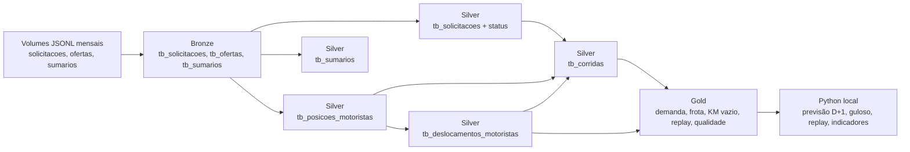

# Medalhão no Databricks: Bronze, Silver e Gold

**Atualizado em 14/10/2026.** Esta página descreve a preparação dos extratos Elasticsearch no workspace Databricks Free Edition. As tabelas foram geradas e conferidas por execução real no workspace (serverless), a partir do VS Code com Databricks Connect. Previsão, alocação gulosa e simulação **não** rodam no Databricks: o núcleo Python em `src/tcc_frota/` lê as tabelas Gold e faz essa parte.



## Catálogos e notebooks

| Camada | Catálogo.schema | Notebooks (`databricks/catalog/<catálogo>/db_frota/`) |
|---|---|---|
| Bronze | `cat_mobilidade_urbana_bronze.db_frota` | `nb_bro_solicitacoes`, `nb_bro_ofertas`, `nb_bro_sumarios` (feitos pelo proponente) |
| Silver | `cat_mobilidade_urbana_silver.db_frota` | `nb_slv_solicitacoes`, `nb_slv_posicoes_motoristas`, `nb_slv_sumarios`, `nb_slv_corridas` |
| Gold | `cat_mobilidade_urbana_gold.db_frota` | `nb_gld_demanda`, `nb_gld_frota`, `nb_gld_km_vazio`, `nb_gld_qualidade` |

Execute na ordem acima. Pelo VS Code, com o `.venv` do Databricks Connect:

```powershell
$env:DATABRICKS_CONFIG_PROFILE = 'entonysantos'
.venv\Scripts\python.exe databricks\setup\executar_notebooks.py silver gold
```

Os notebooks também rodam diretamente no workspace (a variável `spark` já existe). Todas as gravações são `overwrite` idempotentes.

## Evidências que sustentam os tratamentos

Perfil agregado das tabelas Bronze em 14/10/2026, sem exibir registros:

- **Volume:** 451.386 solicitações (451.386 códigos distintos), 262.708 snapshots de ofertas e de sumários, 10.556.363 entradas de oferta, de 01/10/2025 a 30/09/2026. Bate com a auditoria local de `docs/elasticsearch_local.md`.
- **Fuso:** todos os carimbos têm offset `-03:00`. Datas e horas locais usam `America/Sao_Paulo`.
- **Ciclo da solicitação:** `dT_ACEITE_MOTORISTA` = primeiro `CondutorACaminho` e `dT_INICIO_REALIZADA` = primeiro `CorridaIniciada` (diferença mediana e p99 = 0 s). Em `TempoReal`, `dT_REGISTRO` = primeiro `AguardandoCondutor` (mediana 0 s; hora local diferente em 1,5%).
- **Ofertante = motorista:** `ofertaList.codigo` coincide com os 431 `cD_MOTORISTA` das solicitações e com apenas 1 `cD_VEICULO`. Em 89% dos dias o motorista usa um só veículo.
- **Enum de estado (inferido, não documentado):** comparando cada snapshot com `tb_sumarios` do mesmo `codigo`, as contagens coincidem em 100% dos snapshots: `1` = Online, `3` sem passageiro = A caminho, `3` com passageiro = Com passageiro, `4` = Selecionado, `5` = Indisponível. Motorista Offline não aparece na lista.
- **GPS:** cadência de 120 s (p99 123 s), 5 lacunas de rede acima de 10 min em um ano, idade mediana da posição de 3 s.

## Silver: tratamentos

| Tabela | Grão | Tratamentos principais |
|---|---|---|
| `tb_solicitacoes` | solicitação | dedup por `codigo` (RN003); tipagem; marcos do ciclo de vida (documento, com log como reserva); `categoria_desfecho` e `grupo_desfecho` sem atribuir causa (RN004); durações; `fl_tempos_ordenados`; `base_temporal_demanda` rotulada como proxy (RN023) |
| `tb_solicitacoes_status` | evento de status | `logStatus` em formato longo, deduplicado |
| `tb_posicoes_motoristas` | motorista × snapshot | explosão de `ofertaList`; `estado`; `ts_posicao` e idade; `fl_coordenada_valida`, `fl_posicao_atual` (-60 a 300 s), `fl_bbox_grande_vitoria` (retângulo aproximado, RN002 pendente); H3 r8 e r7 |
| `tb_deslocamentos_motoristas` | trecho entre posições consecutivas | Haversine (R = 6371,0088 km, mesmo de `distance.py`); `categoria_km` = estado no início; trecho inválido se intervalo > 300 s (lacuna, não zero) ou velocidade > 150 km/h |
| `tb_sumarios` | snapshot | contadores tipados e `fl_consistente_com_posicoes` |
| `tb_corridas` | corrida encerrada | posição de aceite, origem (embarque) e destino (desembarque) pelo GPS do próprio motorista mais próximo do marco (até 180 s; confiável até 120 s); KM em linha reta e KM por GPS amostrado de pickup e viagem |

Resultados da execução: 222.359 corridas, 99,8% com origem e destino confiáveis; 100% das atendidas com tempos ordenados; trechos inválidos abaixo de 0,5%.

## Gold: refinamento para o Python

| Tabela | Uso no Python |
|---|---|
| `tb_dim_zonas_h3` | geometria das células H3 r8/r7 (centróides). Sem volume, para não vazar futuro na malha |
| `tb_demanda_zona_hora` | contagem histórica de **corridas atendidas** por data, hora e zona de origem → previsão D+1 por zona |
| `tb_demanda_regional_hora` | todas as solicitações por data, hora e desfecho, sem zona → demanda total e não atendimento |
| `tb_frota_sessoes` | janelas de presença por motorista (pseudônimo) e estado → `available_from/until` e posição inicial |
| `tb_frota_motorista_hora` | minutos por estado e primeira posição em cada hora → frota esperada em D+1 e posição no corte |
| `tb_km_vazio_segmentos` | KM sem passageiro entre corridas consecutivas, em parcelas separadas → referência histórica |
| `tb_km_vazio_diario` | totais diários dos segmentos válidos e KM GPS da frota por estado |
| `tb_corridas_replay` | corridas com origem/destino confiáveis (coordenadas com 3 casas) → pedidos do replay |
| `tb_qualidade_dados` | cobertura, perdas por filtro e validade (RN027) |

As parcelas de KM vazio ficam separadas porque o KPI corporativo segue pendente (DT003, RN010–RN011). `km_reta_fim_ate_origem` reproduz a definição do PDF; as colunas `km_gps_*` somam trechos GPS amostrados. Ambas são estimativas, nunca odômetro (RN012).

## Limites que o Python precisa respeitar

1. **Corte D+1 (RN020):** as tabelas guardam o histórico inteiro. Filtre `data_local` < data do corte antes de estimar demanda, frota ou malha.
2. **Demanda atendida ≠ demanda total:** pedidos não atendidos não têm origem nesta fonte. Cobertura espacial é condicional às corridas observadas (matriz, §19 item 4).
3. **Unidade de frota:** o GPS segue o motorista. Um veículo pode ser dividido entre motoristas; ocupações de outras modalidades aparecem porque o motorista fica em `A_CAMINHO`/`COM_PASSAGEIRO` (RN026).
4. **Segmento válido:** sem lacuna de GPS e sem passagem por `INDISPONIVEL`. Troca de turno ou pausa não entram como KM morto nem como zero.
5. **Base temporal:** `dT_REGISTRO` é a entrada na fila de despacho, usada como proxy de criação; a homologação continua pendente (RN023). O enum de estado é inferido empiricamente.

## Dados e segurança

A ingestão Bronze foi feita pelo proponente no próprio workspace. Esta etapa não baixou registros para a máquina local: execuções e conferências usaram apenas agregados. Na Gold, motorista e veículo usam pseudônimo SHA-256 truncado (não é anonimização) e as coordenadas de passageiros têm 3 casas decimais. Consulte [segurança dos dados](seguranca_dados.md).
