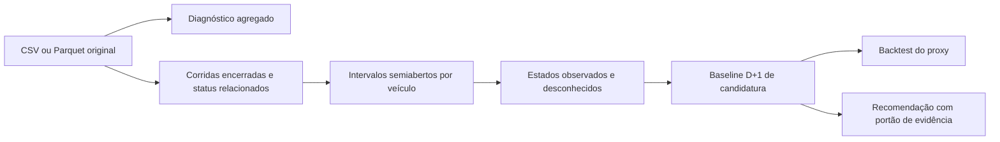

# Disponibilidade operacional D+1: primeira versão

Este módulo apoia a elegibilidade futura da frota para o estudo de alocação preventiva. O objetivo acadêmico principal permanece a redução de KM morto; a previsão individual de disponibilidade só pode alimentar o algoritmo quando a evidência for suficiente. A matriz de regras e seus status permanecem em `docs/REGRAS_NEGOCIO_TCC.md` no contexto local autorizado.

## Fontes e estado

Os nove extratos presentes em `data/` são **CSV**: `CORRIDAS_V1`, `EVENTOS_STATUS_MOTORISTAS`, `JORNADAS_MOTORISTAS`, `JORNADAS_CORRIDAS`, `REPOSICIONAMENTOS`, `COBLI_EVENTOS`, `VEICULOS`, `HISTORICO_VEICULOS` e `AGENDAMENTOS`. O leitor também aceita arquivos Parquet por dataset e partições `ano/mês` quando forem disponibilizados. Os originais nunca são regravados. O fuso `America/Sao_Paulo` foi informado pelo proponente; a origem do fuso nos sistemas ainda precisa de validação.



## Regras implementadas

- `CorridaEncerrada` com veículo e intervalo válido gera `EM_CORRIDA`. Versões encerradas conflitantes da mesma solicitação são excluídas e contadas (RN003/RN017).
- Log de motorista entra apenas com `qualidade_relacionamento=RELACIONADO` e `qualidade_intervalo=COMPLETO`. `Online` indica aptidão para receber uma corrida, mas o intervalo fica `ONLINE_SEM_OCUPACAO_IDENTIFICADA`; corrida ativa prevalece. `Indisponivel` bloqueia; `Offline` não comprova por si só o estado do veículo compartilhado.
- Intervalos são `[início, fim)`. Fim ausente ou não posterior ao início não cria ocupação infinita. Dois motoristas simultâneos sem ocupação comprovada geram `DESCONHECIDO` e conflito. Lacuna temporal também é `DESCONHECIDO`.
- O baseline histórico usa apenas intervalos encerrados até o corte D. Ele estima a frequência de **candidatura Online** por veículo, dia da semana e hora; desconhecidos não viram exemplos negativos. Não chama essa frequência de probabilidade validada de disponibilidade.
- O backtest avalia o proxy em um dia posterior, separado do treino, e relata cobertura e Brier apenas onde há rótulo observável. O corte de 20h é uma hipótese experimental inicial, configurável; compare outros cortes e períodos antes de escolher um operacional.
- O ranking exige probabilidade de disponibilidade validada, região validada e elegibilidade explícita. Como nenhum desses dois primeiros elementos foi confirmado, a execução real atual não recomenda veículos individualmente.

## Execução local

Na raiz do repositório, com Python 3.12+:

```powershell
python -m pip install -e ".[test]"
tcc-frota-disponibilidade --data-root data audit --from-date 2025-01-01 --through-date 2026-10-13 --output reports/runs/availability_diagnostic.jsonl
tcc-frota-disponibilidade --data-root data relationships
tcc-frota-disponibilidade --data-root data reconstruct --start 2026-10-13T00:00:00 --end 2026-10-14T00:00:00 --as-of 2026-10-14T23:59:59 --output reports/runs/availability_timeline.jsonl
tcc-frota-disponibilidade --data-root data forecast-candidates --cutoff 2026-10-12T20:00:00 --target-date 2026-10-13 --lookback-days 56 --evaluation-as-of 2026-10-14T23:59:59 --output reports/runs/forecast_candidates.jsonl
```

Os exemplos de data acima documentam um ensaio retrospectivo, sem datas fixas no código. Para novos dias, informe `--cutoff`, `--target-date` e `--evaluation-as-of` coerentes. O arquivo individual é opcional e só pode ser gravado em `reports/runs/`, ignorado pelo Git. Sem `--output`, os comandos exibem apenas agregados.

Para explorar os artefatos locais, instale o extra `ui` e execute `streamlit run app/availability.py --server.address 127.0.0.1`. A interface não lê os CSVs originais. O extra `parquet` instala PyArrow quando houver Parquets. [Segurança dos dados](seguranca_dados.md) descreve o tratamento dos artefatos.

## Próximos gates

1. Confirmar temporalidade e método de exportação de `DT_REGISTRO`, os horários de corte e a situação de agendamentos já conhecidos no corte (RN020/RN023).
2. Validar relação temporal placa–`CD_VEICULO` para Cobli e distinguir `trips` de corrida, pickup e reposicionamento; `stops` nunca comprova liberdade sozinho.
3. Validar `DT_ACEITE`, `DT_RECUSA` e `DT_FIM` antes de marcar reposicionamento como ocupação; vincular motorista a veículo somente com relação comprovada.
4. Reconstruir jornada, manutenção, pausas e compromissos compartilhados antes de criar rótulos positivos de disponibilidade (RN015/RN016/RN026).
5. Testar previsão de região e disponibilidade real em múltiplos períodos; só então habilitar ranking. A interface atual mostra as etapas existentes e indica as ausentes.
