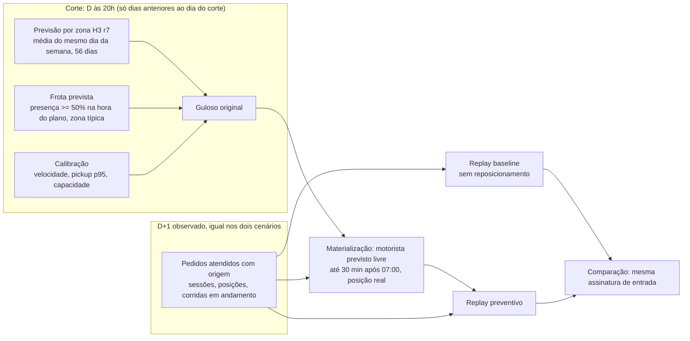

# Experimento D+1 com dados reais (Gold Databricks)

**Atualizado em 14/10/2026.** O experimento usa a Gold descrita em [databricks_medalhao.md](databricks_medalhao.md) e o núcleo Python original: previsão por média histórica, guloso (DT001) e simulador de eventos. A decisão de desenho está em DT011 (registro local). Os números são **estimativas geodésicas** sobre pedidos e frota reais; não são economia observada nem KPI corporativo (DT003).

## Pergunta operacional do ensaio

Com o que se sabe às 20h de D, um plano de reposicionamento preventivo para 07:00–10:00 de D+1 reduz o KM vazio estimado (pickup + reposicionamento) em relação a não reposicionar, sem piorar a cobertura, nos mesmos pedidos, frota e método de distância?

## Fluxo por dia avaliado



## Execução

```powershell
$env:TCC_REAL_DATA_AUTHORIZED = 'YES'
$env:DATABRICKS_CONFIG_PROFILE = 'entonysantos'
.venv\Scripts\python.exe -m tcc_frota.cli gold-export                      # cache em reports/runs/gold_cache
.venv\Scripts\python.exe -m tcc_frota.cli gold-replay --start 2026-09-01 --end 2026-09-30 --workers 7
```

Opções de sensibilidade: `--plan-hour`, `--horizon-hours`, `--lookback-days`, `--min-presence-rate`, `--max-reposition-km`, `--execution-tolerance-minutes` e `--oracle-fleet`. O oráculo planeja com a frota livre e as posições **reais** às 07:00 de D+1. Ele viola o corte e serve apenas para separar o erro de previsão da frota do limite do próprio algoritmo. Resultados ficam em `reports/runs/gold_replay/<run_id>/result.json`, ignorado pelo Git, só com agregados por dia.

## Regras do ensaio

- **Corte (RN020):** demanda, presença, posição típica e calibração usam apenas datas locais anteriores ao dia do corte. Testes garantem que linhas do dia do corte e de D+1 não mudam a previsão nem a frota prevista.
- **Comparabilidade (RN028):** os dois cenários recebem os mesmos pedidos, sessões, compromissos, velocidade, pickup máximo e estimador; o `compare` exige a mesma assinatura SHA-256.
- **Ocupação (RN017, RN026):** corridas em andamento no início do horizonte viram compromissos com posição final; um veículo não atende duas corridas ao mesmo tempo.
- **KM (RN011, RN031):** o reposicionamento executado entra no total do cenário preventivo. Retorno à base não é medido.
- **Baseline (RN021):** despacho do veículo livre mais próximo, sem fila nem reposicionamento. É uma simplificação, não a política real. O KM de pickup histórico observado é exibido só como referência descritiva.
- **Universo:** corridas atendidas com origem e destino confiáveis. Pedidos não atendidos não têm origem nesta fonte; a cobertura é condicional.

## Resultados: setembro de 2026 (30 dias, um corte por dia)

Execução local em 14/10/2026 sobre o cache da Gold exportado no mesmo dia. Cada linha varia **um** fator em relação ao padrão (plano às 07:00, horizonte de 3 h, presença ≥ 50%, reposicionamento ≤ 12 km, tolerância de 30 min). KM vazio = pickup + reposicionamento, Haversine estimado. Redução positiva = preventivo melhor.

| Cenário | Recomendações | Aplicadas | Pickup baseline (km) | Pickup preventivo (km) | Reposicionamento (km) | Redução KM vazio, 30 dias | Cobertura baseline → preventivo | Dias sem piora de cobertura | Redução nesses dias |
|---|---:|---:|---:|---:|---:|---:|---|---:|---:|
| Padrão (D+1 estrito) | 640 | 129 | 4.603,2 | 4.536,9 | 737,4 | **−14,6%** | 93,3% → 92,4% | 17 | −15,0% |
| Oráculo: frota real às 07:00 (viola o corte) | 133 | 114 | 4.603,2 | 4.577,3 | 439,9 | −9,0% | 93,3% → 92,4% | 14 | −12,0% |
| Reposicionamento ≤ 3 km | 630 | 33 | 4.603,2 | 4.587,7 | 62,6 | −1,0% | 93,3% → 93,2% | 26 | −1,0% |
| Presença prevista ≥ 75% | 294 | 59 | 4.603,2 | 4.584,9 | 340,5 | −7,0% | 93,3% → 92,7% | 19 | −6,0% |
| Tolerância de execução 0 min | 640 | 35 | 4.603,2 | 4.617,3 | 182,9 | −4,3% | 93,3% → 93,0% | 24 | −3,8% |
| Plano às 17:00 (17–20 h) | 568 | 108 | 2.519,9 | 2.528,7 | 473,8 | −19,2% | 94,0% → 93,3% | 21 | −23,0% |

Universo do padrão: 2.047 corridas atendidas com origem confiável na janela 07–10 h, média de 80 sessões de motoristas por dia, 51,8 motoristas previstos por corte. Calibração média do treino: 10,7 km/h em linha reta, pickup máximo (p95) de 46,3 min, 0,51 corrida por motorista-hora. Erro absoluto médio da previsão do total da janela: 13,1 corridas por dia (2.290 previstas para 2.047 observadas).

### Leitura

1. **Nenhuma configuração reduziu o KM vazio estimado.** O reposicionamento custou mais do que economizou em pickup; em vários dias a cobertura simulada também caiu. O resultado repete o ensaio sintético (0,0%, [resultados.md](resultados.md)) com sinal mais desfavorável.
2. **O problema não é só a previsão da frota.** Com a frota e as posições reais (oráculo), a perda continua (−9,0%). A previsão de presença reduz a adesão (só 20% das recomendações executáveis no padrão), mas não explica o sinal negativo sozinha.
3. **O objetivo aproximado do guloso superestima o ganho.** Na execução com tolerância 0, o plano projetou 5.881 km de economia de pickup para 2.970 km de reposicionamento planejado. No replay, o pickup do cenário preventivo ficou praticamente igual ao do baseline. A aproximação por capacidade e distância ao centróide da zona (DT001) não representa o despacho pedido a pedido.
4. **Movimentos curtos quase não custam nem ajudam:** com limite de 3 km, a variação foi −1,0%.
5. **Referência histórica (descritiva):** na janela padrão, o pickup observado em linha reta somou 6.022 km (8.314 km por GPS amostrado), contra 4.603 km no baseline simulado. O despacho do simulador (veículo livre mais próximo, sem fila) é mais eficiente que a operação real, o que reduz o espaço para ganho do preventivo dentro do replay. Comparar o preventivo diretamente com o histórico misturaria métodos e políticas (RN021, RN028).

### Ameaças à validade

- Linha reta e velocidade constante calibrada; sem rotas nem trânsito (RN012).
- Baseline simplificado: o simulador atende 93% das corridas que na realidade foram atendidas, por não ter fila de espera.
- Demanda atendida, não total; corridas não atendidas não têm origem.
- Um mês (setembro/2026) e duas janelas do dia; não houve ajuste de parâmetros para obter ganho.
- Unidade de frota = motorista com o veículo em uso; enum de estados inferido (DT010).
- O experimento mede o modelo, não a operação: sem adesão real, reação dos motoristas ou mudança de demanda.

### Próximos passos possíveis (dentro do escopo)

A comparação com outros algoritmos está em [comparacao_algoritmos.md](comparacao_algoritmos.md). Discutir com a orientação: (a) usar no guloso um objetivo avaliado por simulação em vez da aproximação por capacidade; (b) recomendar apenas contagens por zona e faixa (§12 da matriz); (c) repetir em outros meses e janelas; (d) validar DT003 e o enum de estados com a empresa.
