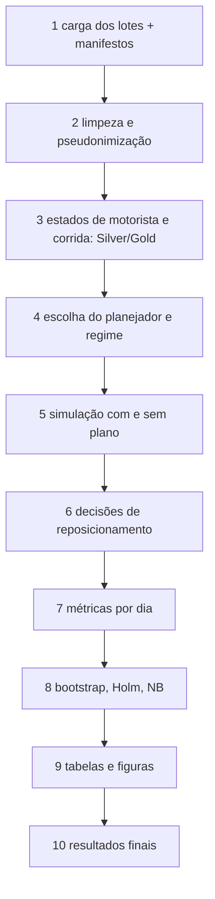

# Guia completo do repositório

Guia para quem não conhece o código: o que o TCC investiga, onde cada coisa está, como instalar, executar, testar e interpretar. Escrito em 28/10/2026 a partir da inspeção do repositório (commit-base `abf4c5c`, ramo `v2-extensoes`). Onde um comando **não foi executado**, o texto diz.

## 1. Visão geral do projeto

**Pergunta.** Em um aplicativo de transporte urbano, mover motoristas ociosos na véspera (alocação preventiva **D+1**), com base só no histórico até o corte, **reduz o KM morto** (km rodado sem passageiro)? Atendimento e cobertura são controles da comparação, não o objetivo.

**Solução computacional.** Um replay offline em Python: para cada dia de teste, o planejador recebe só o que se sabia no fim de D (previsão de demanda por zona H3 resolução 7 e hora, posição/escala da frota) e devolve movimentos `{motorista: (lat, lng, km)}`. Um simulador de eventos atende os mesmos pedidos reais com e sem o plano; compara-se o KM vazio (`pickup + reposicionamento`).

**O que há de algoritmos.** 13 planejadores sob a interface `Planner`: 5 referências do artigo (guloso marginal com α = 0,05/0,2/0,5, proporcional, regra de limiar) e 8 famílias da bateria (fluxo de custo mínimo, húngaro, MILP min(B+R), LNS, recozimento, NSGA-II, MILP robusto, PSO), mais o guloso seletivo (C0–C3) e experimentos fora da tabela principal (MPC intradiário, despacho D+0).

**O que os experimentos avaliam.** KM vazio por corrida, corridas atendidas e custo marginal por corrida extra (`e`), em março e setembro de 2026, regimes de informação A/B. Há ainda a extensão v2 (inferência com bootstrap dependente, controles positivo/negativo, oráculo de demanda, baselines B0–B4, calculadora NB(e\*)).

**O que os resultados significam (registrados no repositório).** Nenhum dos 13 algoritmos reduziu o KM vazio por corrida; a extensão v2 confirma o nulo e mostra, por um controle positivo sintético, que o simulador e a inferência detectam ganho quando ele existe ([RELATORIO_V2](../reports/tcc_v2/RELATORIO_V2.md), [BATERIA_ALGORITMOS](BATERIA_ALGORITMOS.md)). Isso vale para este simulador, estes dados e estas hipóteses; não é política da empresa nem prova de impossibilidade geral (seção 9).

## 2. Estrutura completa do repositório

A estrutura foi **mantida** de propósito (ver [relatório de reorganização](../reports/repository_migration/RELATORIO_REORGANIZACAO.md)): caminhos de `reports/tcc_final`, `reports/tcc_v2`, `resultados/` e `tabelas/` são citados por hashes do pré-registro, pelo artigo e por scripts.

```text
tcc-otimizacao-frota/
├── README.md, AGENTS.md, CLAUDE.md      entrada do projeto e regras para agentes
├── pyproject.toml, uv.lock
├── config/                  business_rules, data_contract, experiment (YAML); custos_privado.yaml (ignorado)
├── src/tcc_frota/           pacote Python (núcleo, v2, v3, algoritmos, availability…)
├── scripts/                 execuções reprodutíveis da bateria e da v3 (um script por fase)
├── tests/unit, tests/integration
├── data/                    dados locais (ignorado pelo Git; só data/synthetic/README.md)
├── resultados/              CSV por dia/semente da bateria (versionado, GERADO)
├── tabelas/                 tabelas LaTeX geradas (versionado, GERADO)
├── reports/
│   ├── tcc_final/           v1 congelada (tag v1-congelada; 19 hashes no pré-registro) — NÃO TOCAR
│   ├── tcc_v2/              resultados da extensão v2 (agregados)
│   ├── thesis_audit/        auditorias (DATA_SCIENCE_AUDIT, code_review_report) — ex-reviews/
│   ├── repository_migration/ baseline, manifesto e validação da reorganização
│   ├── examples/            exemplo sintético
│   └── runs/                saídas individuais (ignorado)
├── docs/                    metodologia, resultados, decisões, pré-registro, este guia
└── tcc-artigo-latex/        manuscrito LaTeX (repositório Git aninhado, próprio)
```

### Pacote `src/tcc_frota/`

| Caminho | Papel |
|---|---|
| `models.py`, `distance.py`, `experiment.py` | modelos (dataclasses), distância e experimento sintético original |
| `cli.py` | comando `tcc-frota` (subcomandos na seção 7) |
| `synthetic/`, `ingestion/`, `quality/`, `spatial/` | gerador sintético, Bronze/Silver locais, auditoria de qualidade, grade espacial |
| `demand/`, `gold/` | previsão temporal; export/replay da Gold do Databricks |
| `optimization/`, `simulation/`, `evaluation/` | guloso original, motor de eventos, métricas do experimento sintético |
| `availability/` | disponibilidade operacional (diagnóstico, linha do tempo, candidatura D+1) |
| `v2/` | rodada final: lotes, regras, Silver/Gold, previsão, frota, simulador com fila, políticas, estatística, figuras, `final-run` |
| `algoritmos/` | bateria de 13 planejadores, protocolo, estatística (Holm), relatório, guloso seletivo |
| `analise/` | demanda, pickup, deslocamento livre, valor líquido |
| `v3/` | extensão v2 do TCC (Fases 1–4, controles, MDE, calculadora NB). Nome do pacote ≠ nome da extensão |

### `scripts/`

`bateria_algoritmos.ps1`, `guloso_seletivo.ps1` (bateria/seletivo); `v3_fase1.py`…`v3_fase4*.py`, `v3_decisao.py`, `v3_mde_nb.py`, `v3_figuras_fase2.py`, `v3_gerar_saidas.py` (Fases da extensão); `rodar_demanda.py`, `rodar_pickup.py`, `reexecucao_sementes.py` (análises); `checagem_independente.py`, `conferencia_seletivo.py`, `nao_vazamento_seletivo.py` (verificações); `validar_baseline.py` (impressão digital do repositório).

### Itens possivelmente não utilizados (não removidos)

`pyproject.toml.bak` (versionado; sem referência encontrada) e `src/tcc_frota.egg-info/` (gerado, ignorado). Decisão de remover fica com o autor.

## 3. Arquitetura do software

Núcleo em dataclasses e funções pequenas; Spark é adaptador opcional; CLIs só orquestram. Organização vertical por domínio científico: dados → previsão → planejamento → simulação → estatística → relatório.

```mermaid
flowchart LR
    RAW[(data/raw — fora do Git)] --> V2RAW[v2/raw, rules, silver]
    V2RAW --> GOLD[v2/gold + forecast]
    GOLD --> FLEET[v2/fleet: regimes A/B/C]
    FLEET --> CTX[PlanContext no corte D]
    CTX --> PL[algoritmos/*: Planner]
    PL --> SIM[v2/sim, v3/sim: simulador]
    SIM --> ST[v2/stats, algoritmos/estatistica, v3/inferencia]
    ST --> OUT[reports/tcc_final, reports/tcc_v2, resultados/, tabelas/]
    OUT --> TEX[tcc-artigo-latex]
```



**Entradas de execução:** `tcc-frota` e `tcc-frota-disponibilidade` (declarados em `pyproject.toml`), `python -m tcc_frota.algoritmos.cli` e os scripts em `scripts/`. **Dependências:** núcleo só stdlib; extra `v2` = h3, numpy, matplotlib, pyarrow, scikit-learn, tzdata (scipy/HiGHS usados pelo MILP). Detalhes: [ARQUITETURA_REORGANIZADA](ARQUITETURA_REORGANIZADA.md) e a [arquitetura anterior](arquitetura.md).

## 4. Fluxo de execução



1. **Carga:** `tcc-frota prepare-raw` confere os lotes de `data/raw/` contra manifestos (`v2/raw.py`). 2. **Pré-processamento:** regras de limpeza (`v2/rules.py`), sal de pseudonimização fora do Git. 3. **Estados:** Silver/Gold locais (`v2/silver.py`, `v2/gold.py`), frota por regime (`v2/fleet.py`). 4. **Seleção:** `Planner` + finalista congelado antes dos dias de teste (`algoritmos/protocolo.py`). 5. **Simulação:** `v2/sim.py` (fila, ocupação exclusiva) e `v3/sim.py` (cópia com contabilização m1/m2 opcional). 6. **Decisões:** `Moves = {motorista: (lat, lng, km)}`. 7. **Métricas:** seção 9. 8. **Estatística:** `v2/stats.py`, `algoritmos/estatistica.py`, `v3/inferencia.py`. 9. **Saídas:** `v2/figures.py`, `algoritmos/relatorio.py`, `v3_gerar_saidas.py`. 10. **Resultados:** `reports/tcc_final/` (v1) e `reports/tcc_v2/`.

## 5. Algoritmos implementados

Todos implementam `Planner` (`algoritmos/base.py`); entrada `PlanContext` (inputs do corte, alvo D+1, janela, regime, simulador calibrado, pseudodias anteriores a D, semente); saída `Moves`. O dia D+1 real só é simulado pelo avaliador externo. Limitação comum: o objetivo interno é um proxy (corridas esperadas = min(λ, κ·motoristas)); o efeito real só o replay mede; nenhum algoritmo é política da empresa.

| Algoritmo | Arquivo | Lógica | Papel / limitação |
|---|---|---|---|
| Guloso marginal (α) | `v2/policy.py` | cada passo escolhe o movimento de maior ganho esperado − α·km; para quando ≤ 0 | referência do artigo; α traça a fronteira |
| Proporcional | `v2/policy.py` | vagas proporcionais à demanda prevista, par mais próximo | referência; move muito |
| Regra de limiar θ | `v2/policy.py` | cada motorista vai à zona de maior ganho/km se ≥ θ | referência; ignora interação |
| 5.1 Fluxo de custo mínimo | `fluxo_custo_minimo.py` | fluxo entre zonas r7 | descarta saltos longos |
| 5.2 Húngaro | `hungaro.py` | atribuição a posições de espera | preenche todas as vagas |
| 5.3 MILP min(B+R) | `milp.py` | HiGHS via `scipy.optimize.milp`, piso de atendimento | com cap=1 não move |
| 5.4 LNS | `busca_local.py` | vizinhança grande avaliada no simulador em pseudodias | tende ao plano vazio |
| 5.5 Recozimento | `recozimento.py` | mesma representação do LNS | idem |
| 5.6 NSGA-II | `nsga2.py` | multiobjetivo sobre parâmetros do fluxo | 1.500 avaliações na calibração |
| 5.7 Robusto | `robusto.py` | MILP com S cenários de demanda | — |
| 5.8 PSO | `pso.py` | enxame, índice de destino por motorista | mais lento (29 s/dia) |
| Guloso seletivo C0–C3 | `guloso_seletivo.py`, `seletivo.py` | economia líquida de km, “permanecer” padrão | 0 movimentos no teste |
| 5.9 MPC, 5.11 D+0 | `mpc.py`, `extras.py`, `sim_estendido.py` | fora do escopo D+1 | tabela própria; D+0 reduz km/corrida atendendo menos |

Complexidades não foram medidas formalmente neste trabalho; só o tempo de plano por dia (critério C5).

## 6. Como instalar o projeto

Requer **Python 3.12** (`requires-python = "==3.12.*"`). Verificado em 28/10/2026: `python -m pytest` na raiz.

```powershell
python -m pip install -e ".[test,v2]"      # núcleo + rodada final (h3, numpy, matplotlib, pyarrow, sklearn)
python -m pip install -e ".[test,excel]"   # só núcleo sintético + openpyxl
```

Sem instalação editável: `PYTHONPATH=src` (Linux/macOS: `export PYTHONPATH=src`). Não testado em Linux/macOS. Dados reais: `data/raw/` (fora do Git), `TCC_REAL_DATA_AUTHORIZED=YES` e sal em `TCC_PSEUDO_SALT` ou `data/.pseudo_salt` (≥ 16 caracteres). Os dados reais **não estão neste repositório**; sem eles só se reexecuta o sintético e se conferem os resultados já versionados..

## 7. Como executar os experimentos

| Comando | O que faz | Dados |
|---|---|---|
| `tcc-frota run-synthetic --out reports/runs` | experimento sintético (semente padrão 20261014) | sintéticos |
| `tcc-frota build-synthetic-data --out reports/runs/medallion` | Bronze/Silver/Gold sintéticos | sintéticos |
| `tcc-frota prepare-raw --raw data/raw` | confere lotes | reais |
| `tcc-frota final-run --raw data/raw --out reports/runs/tcc_final --publish reports/tcc_final` | v1: tabelas e figuras | reais |
| `python -m tcc_frota.algoritmos.cli <comando>`; `scripts/bateria_algoritmos.ps1` | bateria | reais |
| `python scripts/v3_fase1.py` … `v3_fase4.py`, `v3_decisao.py` | extensão v2 | reais (agregados) |
| `tcc-frota-disponibilidade audit/relationships/reconstruct/forecast-candidates` | disponibilidade | CSVs locais |
| `python scripts/validar_baseline.py --out <json>` | impressão digital do repositório | nenhum dado real |

Identificação da execução: a saída individual vai em `reports/runs/<ferramenta>/<run_id>/` (ignorada); agregados publicáveis em `reports/tcc_final/` e `reports/tcc_v2/`. Sementes e grades estão pré-registradas (`docs_antigos/ORCAMENTO_CONFIGURACOES.md`, `docs_antigos/V2_PREREGISTRO.md`; `resultados/registro_configuracoes.csv`). **Não executado nesta reorganização:** `final-run`, bateria e Fases v3 (exigem dados reais ausentes); ver a validação.

## 8. Como executar os testes

```powershell
python -m pytest                       # tudo
python -m pytest tests/reproducibility/test_estrutura_repositorio.py
```

`tests/unit/`: algoritmos (base, busca, fluxo, MILP, NSGA-II), disponibilidade, v2 (política, regras, simulador, estatística, previsão), v3 (controle, decisão, deriva), dedup, corte temporal, cópia sintética. `tests/integration/`: ponta a ponta sintético, medalhão e Elasticsearch local. `test_estrutura_repositorio.py` (novo) protege: 19 hashes da v1, importação de todos os módulos, pontos de entrada, configs, ausência de dados reais versionados, ausência de caminhos absolutos de usuário, links dos documentos novos. Resultado de 28/10/2026: **280 passed, 1 skipped** (antes dos documentos novos: 266 passed, 1 skipped). Limite: testes não substituem a execução com dados reais.

## 9. Como interpretar os resultados

| Métrica | Significado | Unidade | Desejável |
|---|---|---|---|
| KM vazio total | pickup (B) + reposicionamento (R) | km | menor |
| KM vazio por corrida | KM vazio ÷ corridas atendidas | km/corrida | menor (cuidado: atender menos também reduz) |
| Corridas atendidas | pedidos servidos no simulador | contagem | maior (controle) |
| `e` | km vazio por corrida extra | km | menor |
| NB(e\*) | ΔN/dia − Δ(B+R)/dia ÷ e\* | corridas/dia | maior; depende do valor e\* aceito para o km |
| WAPE | erro absoluto ponderado da previsão | % | menor |

**Baseline:** o mesmo dia, pedidos, frota, janela e distância **sem** reposicionamento. **Incerteza:** IC 95% por bootstrap pareado de dias (v1: iid; v2: 8 variantes, IC de decisão = o mais largo), Holm/Romano–Wolf entre famílias, Fieller para a razão `e`, MDE para poder. **Não se pode concluir:** que reposicionar nunca funcionaria na prática; que o resultado vale para outras cidades, regimes ou previsões melhores; que KM estimado seja KM faturado (DT003); qualquer coisa sobre dados sintéticos como se fossem da empresa. Cobertura e limites: [limitacoes.md](limitacoes.md).

## 10. Como o código se relaciona com o TCC

Tabela detalhada: [MAPEAMENTO_TCC_CODIGO.md](MAPEAMENTO_TCC_CODIGO.md).

## 11. Como adicionar um novo algoritmo

1. Crie `src/tcc_frota/algoritmos/<nome>.py` com uma classe que herde `Planner` (`algoritmos/base.py`) e devolva `Moves`; use só o que há em `PlanContext` (nada de D+1).
2. Parâmetros e grade entram **antes** de qualquer resultado em `algoritmos/protocolo.py` (e no orçamento pré-registrado); congele o finalista antes do teste.
3. Registre-o na bateria (`algoritmos/bateria.py`) e na regressão (`algoritmos/regressao.py`, se for referência).
4. Teste em `tests/unit/test_algoritmos_<nome>.py`: contrato da interface, determinismo por semente, nenhum veículo movido duas vezes, km coerente.
5. Rode sob o protocolo único (mesmo mundo, baseline e estatística) e gere critérios com `algoritmos/relatorio.py`. Não altere o protocolo depois de ver resultados; mudanças são “desvios” datados.

## 12. Como adicionar um novo experimento

Crie um script `scripts/<fase>.py` (ou uma função em `v3/`) que: leia parâmetros explícitos (semente, janela, regime, e\*), escreva só agregados em `reports/<pasta>/` e saídas individuais em `reports/runs/`, grave semente + commit nos metadados, e registre hipótese e critérios em documento commitado **antes** de executar (modelo: `docs_antigos/V2_PREREGISTRO.md`). Reutilize `v3/analise.py` para inferência. Adicione teste e atualize `docs/ESTADO_PROJETO.md`.

## 13. Problemas conhecidos e limitações

- Dados reais fora do repositório: a reexecução completa **não foi verificada** nesta reorganização; só impressão digital, importações, compilação, hashes da v1, métricas sintéticas determinísticas e testes.
- Notebooks e adaptador de gravação no Databricks, frontend FleetLab e app Streamlit foram removidos em 06/11/2026.
- Carimbo de pré-registro = histórico do Git local (sem carimbo externo).
- D1/D2 do pré-registro foram pedidos após ver a Fase 1 (sem mudar decisão).
- Simulador e custo de pickup são estimativas; KM estimado ≠ faturado (DT003); RN `PENDENTE`/`PROPOSTA` não são política da empresa.
- Estrutura: `scripts/` plano (19 arquivos), nomenclatura mista pt/en e `v3/` para a “extensão v2” — mantidos para não quebrar caminhos citados; ver pendências no relatório.
- `ARQUITETURA.md` pedido pelo roteiro colidiria com `arquitetura.md` no Windows; usou-se `ARQUITETURA_REORGANIZADA.md`.
- `tcc-artigo-latex/` é repositório Git aninhado (não faz parte do índice deste).

## 14. Boas práticas de manutenção

Não mover `reports/tcc_final`, `reports/tcc_v2`, `resultados/`, `tabelas/` (hashes e citações). Um commit por assunto; refatoração estrutural **nunca** junto de correção científica. Alteração que mude resultado: autorização explícita, novo desvio datado, nova rodada, testes. Antes e depois de qualquer reorganização: `python scripts/validar_baseline.py --out …` e comparar. Dados: nada de `data/`, `reports/runs/`, credenciais ou registros individuais no Git; só agregados. Caminhos com `pathlib`, sem caminhos de usuário. Decisões duráveis em `docs/DECISOES_TECNICAS.md`, progresso em `docs/ESTADO_PROJETO.md`.

## 15. Glossário técnico

- **Alocação preventiva D+1 / reposicionamento:** mover motoristas ociosos na véspera para zonas de demanda esperada.
- **Baseline:** o mesmo cenário sem reposicionamento.
- **Simulação:** replay de eventos dos pedidos reais com a frota planejada.
- **Pickup (distância):** km do motorista até o passageiro.
- **KM morto / vazio:** km sem passageiro = pickup + reposicionamento.
- **H3:** índice hexagonal geoespacial; aqui resolução 7 para zonas.
- **Corte:** instante após o qual nada pode ser usado no planejamento (20h local é hipótese inicial).
- **Regime A/B/C:** quanto da escala do dia seguinte é conhecida no corte.
- **κ:** corridas por motorista-hora calibradas no treino.
- **Semente aleatória:** valor que fixa a sequência pseudoaleatória.
- **Bootstrap:** reamostragem dos dias para obter distribuição empírica do efeito.
- **Intervalo de confiança:** faixa de valores plausíveis para o efeito, com nível 95%.
- **Holm / Romano–Wolf:** correções para múltiplas comparações.
- **Fieller:** intervalo para a razão de duas médias; pode ser ilimitado.
- **MDE:** menor efeito detectável com 80% de poder.
- **NB(e\*):** benefício líquido assumindo que uma corrida extra vale e\* km.
- **Controle positivo/negativo:** cenários onde se sabe que há/não há efeito, para testar o método.
- **Oráculo:** previsão que viola o corte (limite superior).
- **Reprodutibilidade:** reobter os mesmos números com o mesmo código, dados e sementes.
- **Validade experimental:** os resultados respondem de fato à pergunta (sem vazamento do futuro, comparação justa).
