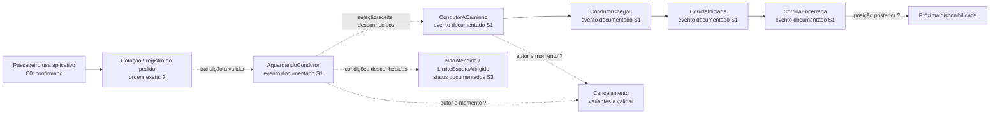

# Regras de negócio e condições de validade — TCC de alocação preventiva de frota

## 1. Identificação do documento

**Projeto:** Otimização da Alocação de Frota em Aplicativos de Transporte Urbano. **Versão:** levantamento inicial, 14/10/2026. **Responsável pela validação operacional:** empresa, a indicar. **Estado:** documento para revisão; nenhuma política de reposicionamento foi homologada. **Escopo desta entrega:** análise documental e inspeção estrutural de arquivos locais, sem consulta ao banco de produção, sem execução de API e sem implementação.

## 2. Objetivo do levantamento

Determinar o que se sabe, o que se pode medir e quais decisões faltam para testar recomendações preventivas D+1 que reduzam KM sem passageiro, mantendo a cobertura e o atendimento sob controle. O contexto fornecido pelo proponente confirma o **objetivo acadêmico**, mas não confirma por si só regras internas da empresa. Neste documento, **CONFIRMADA** significa explicitamente sustentada pelas fontes citadas, dentro do alcance delas; **PROPOSTA** é uma regra de modelagem a aprovar; **PENDENTE** exige dado ou resposta; **CONFLITANTE** designa definições incompatíveis. Uma regra confirmada por código de análise pode confirmar o *uso analítico* de um campo, sem provar a política operacional da empresa.

## 3. Fontes analisadas

Inventário da árvore de trabalho, incluindo arquivos ignorados pelo Git, em 14/10/2026. Arquivos de origem não foram alterados.

| Código | Fonte e alcance | Constatação útil | Limite |
|---|---|---|---|
| C0 | Enunciado do TCC fornecido nesta solicitação | Frota própria, Grande Vitória e viagens estaduais; objetivo de reduzir KM morto; D+1 sem tempo real | Declaração do projeto, não validação da operação |
| S1 | [Dicionário do banco](../sql/DICIONARIO_BANCO.md) §§1–3, 8 | Chaves, eventos, unidades; testes de DP e retorno em amostra PF | Mistura testes verificados e precedentes; cobertura de amostra não é universal |
| S2 | [Contexto do repositório](../CLAUDE.md), seções “Fatos verificados sobre o banco” e “Dados” | Convenções de deduplicação e advertências sobre campos | Contexto de análises de preço, não especificação do TCC |
| S3 | [Consulta do funil](../sql/funil_conversao.sql), RESULT SETS 1–2, e [relatório](../analises/funil_conversao_v1/README.md) | Solicitações e desfechos, inclusive `NaoAtendida`, no recorte PF não Prime | Relatório contém inferências; taxas dependem de filtros e da data do status final |
| S4 | [Extração de coordenadas](../analises/frota_dedicada_pj_v1/sql/04_coordenadas_corridas.sql), comentário e SELECT | Pares de origem, destino solicitado e destino real em `APP_SOLICITACAO_HIST` | Existência da coluna não prova cobertura para toda a demanda |
| S5 | [Frota dedicada](../analises/frota_dedicada_pj_v1/README.md) e [pendências](../analises/frota_dedicada_pj_v1/PENDENCIAS.md) | Jornada, frota Prime, cessão/transbordo e limites de replay | Estudo específico de Prime/PJ; versões antigas foram superadas |
| S6 | [API Sigma](../sigma_api/docs/sigma-api-doc.md) e [README](../sigma_api/README.md) | Payload de posição recente, status e fim de turno; API lista motoristas não Prime | Documento de API, sem histórico de snapshots disponível |
| S7 | [Planilha de rodagem](../analises/km_por_placa/dados/bruto/operacao/Distancia_percorrida.xlxs.xlsx) e [notebook](../analises/km_por_placa/notebooks/analise_placa_km_2026_v1_grande_vitoria.ipynb) | Rodagem mensal por placa, jan–mar/2026 | Não fornece trajeto, eventos nem motivo dos quilômetros |
| S8 | [SQL de KM faturado](../sql/km_faturado_por_placa.sql) e [saída](../analises/km_por_placa/outputs/km_faturado_por_placa_2026.xlsx) | Soma `NU_DISTPERCORRIDA/1000` por placa/mês | Consulta não deduplica histórico; recortes devem ser reconciliados |
| S9 | [Planilha antiga Prime](../analises/frota_dedicada_pj_v1/dados/tabelas/frota_prime_20260817.xlsx) | Cadastro com placa, tipo, região, status e centro de custo | [S5](../analises/frota_dedicada_pj_v1/PENDENCIAS.md) declara esta lista incompleta e superada |
| S10 | [Custos da operação](../analises/custos_operacao_v1/README.md) e [equações de preço](../analises/dre_simulacoes_preco/docs/equacoes.md) | Existe estudo de custo/precificação | Planilha financeira original mencionada no README não está na árvore |

**Ausências:** não há PDF da primeira versão do TCC, CSV, XLS, Parquet, extrato transacional de corrida/solicitação/GPS ou documentação aprovada da política de despacho na árvore local. Há **11 arquivos XLSX**: um relatório operacional bruto de rodagem, uma exportação antiga de frota e nove artefatos de análise/modelo. Consultas SQL e notebooks indicam como extrair dados, mas não substituem os extratos. O inventário completo dos XLSX está na seção 17. Não se acessou o banco, a API nem arquivos externos nesta etapa.

## 4. Contexto operacional

**CONFIRMADA para o escopo do TCC (C0):** operação na Grande Vitória com viagens estaduais, aplicativo para solicitação, frota própria variável, necessidade de reduzir deslocamentos sem passageiro e possibilidade de não atendimento. **CONFIRMADA para o repositório:** existem produtos/cortes PF, PJ e Prime, corridas agendadas e serviços fora da região 1 (S1, S3, S5). A afirmação “frota própria” não prova exclusividade: contratação de agregados, aluguel e cessão entre produtos seguem **PENDENTES**. O objetivo é reduzir KM morto; ampliar corridas atendidas não pode mascarar aumento de KM ou perda de cobertura.

## 5. Glossário de termos

| Termo | Uso neste documento | Situação |
|---|---|---|
| Solicitação | Pedido identificado por `CD_SOLICITACAO` em `APP_SOLICITACAO_HIST` | CONFIRMADA como entidade de banco (S1, S3); momento exato do pedido, PENDENTE |
| Cotação/estimativa | Registro de preço anterior à solicitação | CONFIRMADA (S1, S3); não equivale a demanda não atendida |
| Corrida atendida | Solicitação que alcançou desfecho de viagem; critério exato de conclusão/valor a fixar | PENDENTE para o TCC |
| DP / pickup | Deslocamento após `CondutorACaminho` até `CondutorChegou` | CONFIRMADA como perna analítica (S1) |
| DV | Distância da viagem com passageiro, `NU_DISTPERCORRIDA` no uso do repositório | CONFIRMADA como precedente analítico (S1) |
| DR / retorno | Estimativa de retorno existente em precificação, sem prova de trajeto realizado | CONFIRMADA a limitação (S1) |
| KM morto observado | Distância efetivamente registrada sem passageiro, com segmento/motivo identificáveis | Definição PROPOSTA; não disponível por segmento |
| KM morto estimado | Distância de deslocamento vazio inferida de pontos/rota, declarada como estimativa | Definição PROPOSTA |
| Rodagem total | Distância mensal por placa em S7, incluindo viagens com e sem passageiro segundo o notebook | CONFIRMADA como descrição do arquivo; método do rastreador PENDENTE |
| D+1 | Plano produzido no dia D para execução no dia civil seguinte | PROPOSTA; horário e vigência PENDENTES |
| Região 1 | Código usado nas análises como Grande Vitória | CONFIRMADA no uso analítico (S1, S4) |
| Prime / cessão / transbordo | Produto Prime; “cessão” é corrida não Prime em placa Prime; “transbordo”, corrida Prime fora dessa frota | CONFIRMADA no estudo S5; aplicabilidade ao TCC PENDENTE |

## 6. Modelo de operação da frota

| Tema | Evidência / status | Efeito sobre a alocação |
|---|---|---|
| Propriedade e agregados | C0 declara frota própria; exclusividade e eventual locação/terceirização **PENDENTES** | Define universo elegível e custo marginal |
| Categorias e serviços | `TX_MODELO_SOLICITACAO`, `CD_TIPO_SERVICO`, Prime e PF/PJ aparecem em S1/S3/S5: **CONFIRMADA** a segmentação dos registros | Compatibilidade veículo–serviço não está provada |
| Capacidade de assentos/acessibilidade | **PENDENTE** | Pode invalidar atribuições; não assumir veículos intercambiáveis |
| Frota ativa | S5 identifica cadastro de veículos e presença/jornada em estudo Prime; quantidade futura e vínculo veículo–motorista para o escopo geral **PENDENTES** | Limita recomendações por horário e evita usar carro inativo |
| Turnos/pausas/manutenção | S5 evidencia tabelas de jornada e log de status; também relata chaves de motorista incompatíveis entre tabelas | Reconstrução exige chave homologada; pausa não pode ser inferida como disponibilidade |
| Base/garagem e fim de turno | S6 documenta campo `fimTurno` opcional, não obrigação universal de retorno | Local de espera e fim de jornada são restrições a validar |
| Restrições geográficas e locais de espera | **PENDENTES** | Podem eliminar zonas e impedir reposicionamento |
| Reposicionamento autorizado, limite, custo, aceitação do motorista | **PENDENTES** | Sem autorização não se pode recomendar movimento como política implantável |

O estudo S5 registra 23 placas Prime por centro de custo e confirma que a exportação de 17/08/2026 com 18 placas ficou obsoleta. Esse número **não é** o tamanho da frota elegível do TCC. A mesma fonte mostra cessão entre Prime e não Prime; portanto, filtrar somente pelo modelo da solicitação omite ocupação de placas compartilhadas.

## 7. Ciclo de vida das corridas

S1 documenta os eventos observados em `APP_LOG_STATUS_SOLICITACAO`: `AguardandoCondutor`, `CondutorACaminho`, `CondutorChegou`, `CorridaIniciada`, `CorridaEncerrada`. O repositório interpreta “a caminho” como início do compromisso do carro, “chegou” como fim do deslocamento de pickup, “iniciada” como embarque e “encerrada” como fim da viagem. Esses marcos são **CONFIRMADOS como semântica analítica documentada**; não há prova de que toda modalidade percorra todos os estados. `DT_REGISTRO` em `APP_SOLICITACAO_HIST` é carimbo **da linha de status**, não necessariamente da criação do pedido (S1). S3 contém `NaoAtendida`, `LimiteEsperaAtingido` e cancelamento de operador como possíveis desfechos; autoria e regras de cancelamento seguem pendentes.

**PENDENTE:** momento de registro da solicitação, despacho automático/manual, aceitação e recusa pelo motorista, cancelamentos pelo passageiro/motorista, expiração, repetição de tentativas, seleção de veículo, desfecho de agendamento e local após desembarque. `CD_AGENDAMENTO` documenta corridas agendadas (S1), mas o horário pedido e a política de reserva são desconhecidos. Viagens estaduais existem no escopo declarado C0; a modalidade que entra no experimento ainda deve ser fechada.

## 8. Disponibilidade dos veículos

Somente os seguintes **marcos observáveis** estão documentados: status atual de motorista e última posição na API Sigma **não Prime** (S6); início/fim de jornada e logs de status em análises Prime (S5); `CondutorACaminho` e `CorridaEncerrada` para ocupação por corrida (S1/S5). A API não prova histórico arquivado. Não se define aqui uma máquina oficial de estados da empresa.

**PROPOSTA para o simulador:** veículo “elegível e livre” exige veículo ativo, motorista apto/presente, ausência de corrida aceita ou em andamento, ausência de pausa/manutenção/compromisso agendado e posição conhecida no instante. O intervalo ocupado começa no compromisso documentado (`CondutorACaminho`, ou evento anterior se confirmado) e termina no fim da viagem mais obrigações posteriores comprovadas. Intervalo entre corridas não é automaticamente tempo livre: pode incluir espera, reposicionamento, pausa ou indisponibilidade. Último destino é apenas proxy de posição; S6 prevê GPS posterior. S5 alerta que `APP_LOG_STATUS_MOTORISTA.CD_MOTORISTA` e `APP_JORNADA_MOTORISTA.CD_MOTORISTA` não se unem diretamente no estudo analisado. **Conclusão:** disponibilidade histórica da frota geral ainda não é reconstruível com segurança a partir dos arquivos presentes.

## 9. Definição e cálculo do KM morto

### 9.1 Evidência e alcance

| Perna / medida | Estado | Origem | Interpretação segura |
|---|---|---|---|
| Aceite → chegada ao passageiro | **CONFIRMADA como distância registrada de pickup**, unidade metros; `NU_DISTANCIA_ACEITE_CHEGUEI` é precedente de realizado | S1 §1 | Pode compor KM sem passageiro, sujeito à regra empresarial e cobertura do campo |
| `NU_DP` | **CONFIRMADA como estimativa**, não realizado; igual à estimativa em 100% de 1.023 corridas testadas | S1 §1 | Não usar como KM observado |
| `NU_DISTPERCORRIDA` | **CONFIRMADA como DV/faturado no uso analítico**, metros | S1 §1, S8 | Não subtrair cegamente de telemetria sem recorte e reconciliação |
| `NU_DR_REAL` / `NU_TEMPO_DR` | **CONFIRMADA a suspeita de valor derivado da estimativa**: `NU_DR_REAL` igual ao estimado em 96,8% da amostra | S1 §1 | Não declarar retorno real medido |
| Rodagem mensal por placa | **CONFIRMADA a existência** de planilha jan–mar/2026, km por placa | S7 | Fornece agregado, não trecho sem passageiro nem rota |
| GPS atual | **CONFIRMADA a existência do campo na API**, sem snapshots históricos locais | S6 | Não comprova telemetria contínua histórica |

**Definição empresarial de KM morto: PENDENTE.** Proposta a validar: somar apenas segmentos efetivamente percorridos **sem passageiro** e diretamente atribuíveis à operação estudada, categorizados sem sobreposição em (a) aproximação ao embarque, (b) reposicionamento entre corridas e (c) retorno obrigatório à base, se aplicável. Deslocamentos para abastecimento, manutenção, troca de turno e viagens com passageiro sem receita devem ter categoria própria até a empresa decidir se entram. Uma viagem sem receita **não vira** KM vazio se houve passageiro.

**KM morto observado** exige rastreamento de percurso/odômetro por segmento ou distância registrada com semântica de realizado validada. **KM morto estimado** usa posições conhecidas e distância de rede/rota parametrizada, com fonte, período e taxa de cobertura; Haversine é distância em linha reta e não equivale a rodagem. Sem coordenada válida ou tempo consistente, marcar segmento como **não mensurável**, não como zero. O saldo mensal `rodagem total − DV faturada` pode servir **apenas como indicador agregado de km não faturado**, desde que placas, meses, modalidades e integridade sejam reconciliados; contém usos não identificados e não é automaticamente KM morto. S8 pode duplicar corridas porque consulta `APP_SOLICITACAO_HIST` sem deduplicação, exigindo auditoria antes da subtração.

| Questão específica | Situação |
|---|---|
| Pickup entra? Entre corridas entra? Reposicionamento entra? Retorno entra? Abastecimento/manutenção entram? | **PENDENTE** de política empresarial; proposta acima é metodologia, não regra vigente |
| Telemetria real, GPS histórico, odômetro e forma de medir rodagem? | **PENDENTE**; há planilha agregada e API de posição atual, insuficientes para afirmar a fonte física da medição |
| Distância por API de rotas? | SQL de coordenadas usa pontos; roteamento OSRM é explorado em S5, mas método oficial **PENDENTE** |
| Unidade | S1/S8: metros nas distâncias de corrida; S7: quilômetros no agregado; unidade oficial dos relatórios da empresa **PENDENTE** |
| Custo por km | Parâmetro de precificação existe em S1; custo marginal real e composição **PENDENTES** |

Para comparar cenários, decompor `KM_vazio_total = pickup + reposicionamento + retorno_obrigatório + outros_incluídos` com cada segmento vinculado a veículo, intervalo e motivo. Reposicionamento preventivo é custo do **cenário recomendado**, inclusive quando reduz pickup futuro. Não somar novamente a mesma perna no “retorno” estimado.

## 10. Demanda e solicitações

O banco distingue cotação (`APP_ESTIMATIVA_PRECO`, `CD_ESTIMATIVA`) de solicitação (`APP_SOLICITACAO_HIST`, `CD_SOLICITACAO`) e corrida encerrada (S1/S3). O histórico tem várias linhas por transição; deduplicação é necessária antes de contar solicitações. S3 demonstra status `NaoAtendida`, `LimiteEsperaAtingido` e outros desfechos. **CONFIRMADA:** existe evidência de demanda pós-pedido não atendida no banco, embora o extrato detalhado não esteja nesta árvore. **PENDENTE:** se cada busca sem carro cria pedido, causa exata do desfecho, vínculo de tentativas repetidas e momento da criação. Cancelamento não é sinônimo de ausência de veículo. Cotação sem pedido também não é demanda perdida comprovada; pode ser desistência por preço (S5).

Campos mínimos a obter: `CD_SOLICITACAO`, identificador anonimizado de tentativa/sessão se existir, carimbo de criação do pedido, todos os `TX_STATUS` com carimbo, `CD_ESTIMATIVA`, `CD_AGENDAMENTO`, origem solicitada (coordenada), modalidade, região, `CD_VEICULO`/motorista quando atribuídos. Para atendidas: início/fim, origem/destino real, distâncias e valores. Para não atendidas: estado final, motivo/código e tempo até desfecho. Medir procura por hora e zona de **criação**, não por `DT_REGISTRO` do status final; o funil S3 reconhece deslocamento de solicitações na meia-noite. Padrões por horário, fim de semana e região são plausíveis, mas **não quantificados para este TCC**. Somente corridas concluídas constituiriam demanda **atendida**, nunca demanda total. O recorte de viagens estaduais e os diferentes serviços ainda depende de decisão.

## 11. Política atual de alocação

**PENDENTE.** Nenhuma fonte estabelece política formal de onde aguardar, permanência após desembarque, pontos fixos, escolha do motorista, intervenção do operador, prioridade de região, cobertura mínima, movimentação preventiva, autorização, limites de distância/tempo/custo ou tolerância a recomendação recusada. S5 encontrou transbordo e cessão no produto Prime, mas atribuir isso a uma regra de despacho seria inferência. A referência justa precisa reproduzir decisões/posições históricas ou uma política atual documentada com as mesmas restrições e informações que o cenário proposto. Um baseline “veículo fica no último destino” seria **premissa**, não descrição comprovada da empresa.

## 12. Planejamento preventivo D+1

**CONFIRMADA como diretriz do estudo (C0):** recomendações antecipadas; sem otimização em tempo real. **PROPOSTA:** D+1 = dia civil local posterior ao corte de planejamento. No corte, só podem entrar dados publicados até então, previsão de demanda por faixa/zona, frota/turnos/compromissos conhecidos e localização inicial conhecida ou prevista, identificada como tal. Saída potencial: quantidade por zona e faixa; recomendação por placa apenas se previsão individual de presença e localização for confiável. Horário do corte, duração de cada recomendação, frequência diária, eventuais atualizações operacionais, responsável por usar o plano e obrigação de cumprimento são **PENDENTES**. Não usar corridas ou GPS de D+1 como entrada da decisão de D+1 no experimento.

## 13. Restrições operacionais

“Obrigatória” abaixo significa requisito de **validade do experimento**, não comprovação de política empresarial. Restrições corporativas só se tornam obrigatórias após validação.

| Restrição | Prioridade provisória | Estado / decisão necessária |
|---|---|---|
| Não alocar o mesmo veículo a corridas simultâneas; não exceder veículos elegíveis | Obrigatória | PROPOSTA metodológica; identificar frota ativa por instante |
| Respeitar janelas de jornada, pausas e compromissos existentes | Obrigatória se registros validados | PENDENTE chaves e semântica; S5 documenta erro de junção de motoristas |
| Capacidade, categoria e elegibilidade por serviço | Obrigatória se aplicável | PENDENTE cadastro e política |
| Áreas proibidas e restrições legais/contratuais | Obrigatória se aplicável | PENDENTE; não inventar polígonos |
| Corridas agendadas e retorno à base | Obrigatória se compromisso confirmado | PENDENTE horário pedido e regra de base |
| Limite de KM/tempo de reposicionamento, orçamento e cobertura mínima | Desejável até homologação; obrigatório se contratual | PENDENTE valor, período e unidade |
| Manutenção, indisponibilidade e disponibilidade de motorista | Obrigatória se ocorrer | PENDENTE histórico por veículo/motorista |
| Otimização de despacho em tempo real e roteamento dinâmico durante D+1 | Fora do escopo | C0 |

Não converter um campo opcional `fimTurno` da API em regra geral de retorno à base. A quantidade máxima de veículos ativos não é o total cadastrado; requer presença, manutenção e vínculo de motorista.

## 14. Regras espaciais

`CD_REGIAO = 1` é usado como Grande Vitória em S1/S4. S4 prova campos de coordenadas de origem, destino solicitado e destino real nas corridas examinadas, como texto `varchar` anulável; é necessário validar conversão de vírgula/ponto, intervalos geográficos e cobertura. Bairro não é coluna estruturada no dicionário S1; inferência por endereço é frágil. Municípios existem como `TX_CIDADEORIGEM` e `TX_CIDADEDESTINO_REAL` (S1). Zonas oficiais, pontos de espera, bases, deslocamento entre municípios e regiões de baixa demanda são **PENDENTES**.

Alternativas a testar após observar dispersão e cobertura: municípios/bairros (mais legíveis, potencialmente grandes), grade regular ou H3 (granularidade uniforme; H3 aparece na API S6), agrupamentos por proximidade (adaptativos, menos estáveis). Selecionar resolução com sensibilidade a células vazias, acessibilidade por via e volume amostral. **PENDENTE:** Grande Vitória como fronteira estrita do experimento e tratamento de viagens estaduais que consomem frota local. Não truncar uma viagem estadual na divisa para reduzir artificialmente o tempo ocupado ou o KM.

## 15. Regras temporais

`DT_REGISTRO`, `DT_INICIO_REALIZADA`, `DT_FIM_REALIZADA` e eventos do log têm papéis distintos (S1/S3). S5 registra explicitamente timestamps SQL/CSV sem offset; o **fuso de origem é PENDENTE**, apesar do contexto geográfico ser ES. S3 mostra que agrupar por status final desloca pedidos próximos à meia-noite. Faixa temporal, duração de pickup/espera, viagens cruzando meia-noite, solicitações simultâneas, tempo entre corridas, feriados e disponibilidade por faixa precisam de definição com dados. Agendadas têm esperas diferentes em uma amostra de S1, portanto não misturar sem verificar. **PROPOSTA:** janelas temporais semiabertas `[início, fim)`, ordenação estável de eventos no mesmo instante e calendário local após validar fuso; treino/teste por tempo de conhecimento, não aleatorização de linhas.

## 16. Regras financeiras

S1 documenta `APP_ESTIMATIVA_PRECO.DE_VALOR_KM_VEICULO` em R$/km e `DE_VALOR_HORA_MOTORISTA` que, apesar do nome, foi validado em R$/minuto na amostra citada. Também mostra `DE_CUSTO_VEICULO` gravado pelo **motor de precificação**. Esses são parâmetros de preço/estimativa, **não prova de custo marginal contábil da empresa**. S10 menciona planilha financeira original, ausente. S3 informa motorista assalariado no contexto PF, sem detalhar o custo incremental do reposicionamento.

**PENDENTE:** custo por km efetivo e vigente, diferenciação por veículo, combustível, manutenção, pneus, depreciação, aluguel, mão de obra, custos fixos/variáveis, deslocamento interestadual, efeito de ociosidade e critério de rateio. **PROPOSTA:** resultado principal em quilômetros vazios; custo incremental só após homologar parâmetro e componentes. Distinguir custo **observado** (despesa documentada) de custo **estimado** (`km estimado × R$/km` parametrizado), com análise de sensibilidade. Não somar salário fixo por km como se fosse desembolso incremental sem justificativa. Não importar taxa genérica da literatura como custo da empresa.

## 17. Mapeamento de arquivos e colunas

Inspeção estrutural dos 11 XLSX via metadados internos OpenXML e verificação pontual de chave/medida nas duas fontes operacionais, sem alterar originais nem reproduzir registros pessoais. “Dimensão” é o retângulo declarado pela aba; `linhas = limite superior da dimensão`, **não** contagem garantida de registros. Cabeçalhos foram lidos somente para as duas fontes operacionais e o resumo de KM. Nulos das demais colunas, duplicatas de registros completos e período de todas as abas dependem de auditoria adicional. Não existe CSV local.

| Arquivo XLSX (caminho relativo) | Abas e dimensão (`linhas × colunas` máximas) | Identificadores / tempo / coordenadas / status / lacuna |
|---|---|---|
| `analises/km_por_placa/dados/bruto/operacao/Distancia_percorrida.xlxs.xlsx` | Janeiro, Fevereiro, Março: cada `548 × 6`; **542 linhas com placa ou distância por aba** | Cabeçalho na linha 6: Grupo, Placa, Modelo, Montadora, Ano, Distância percorrida (km). Período jan–mar/2026 indicado nas abas; granularidade pretendida placa/mês. Em cada aba: zero placas/distâncias vazias entre as 542 linhas e **uma chave Placa repetida**; verificar se é repetição legítima ou duplicidade antes de somar. Sem timestamps, coordenadas, status ou trajeto. |
| `analises/frota_dedicada_pj_v1/dados/tabelas/frota_prime_20260817.xlsx` | Frota `238 × 13`; **18 linhas com placa ou status** | Cabeçalho na linha 4: PLACA, COR, TELEFONE, TIPO, MODELO, REGIÃO, TIPO SERVIÇO, AGENDAMENTO ALUGUEL, COBLI, PERIODO SAZONAL, STATUS, CENTRO CUSTO, UF EMPLACAMENTO. Nas 18 linhas, placa e status não estão vazios e placa não se repete; demais colunas não auditadas. Sem coordenadas/turnos. Exportação pontual, declarada obsoleta em S5. Não reproduzir telefone/placas. |
| `analises/km_por_placa/outputs/km_faturado_por_placa_2026.xlsx` | Resumo Executivo `19 × 11`; Por Placa (Consolidado) `447 × 18`; KM Faturado vs Rodado `195 × 13`; Detalhe Placa x Perfil `893 × 12`; Sem Corrida CC V1 `43 × 7` | Saída derivada jan–mar/2026; possível chave placa/mês; validar fórmula, filtro e dedup de S8. |
| `analises/funil_conversao_v1/outputs/funil_conversao_analise.xlsx` | Resumo `40 × 6`; Dados_Diarios `130 × 18`; Motivos_Nao_Atendimento `41 × 7`; Perda_Pos_Pedido `24 × 6`; Blocos_QuiDom `27 × 12`; Quebra_Preco_Junho `25 × 6`; Pareado_DiaSemana `9 × 8`; Serie_Semanal `24 × 8`; Capacidade_e_Demanda `23 × 6` | Saída agregada de funil PF; S3 informa série 01/04–02/08/2026. Sem identificador individual ou posição de veículo. |
| `analises/diagnostico_novo_preco_v1/outputs/composicao_preco_mc02_pf_julho.xlsx` | Resumo `20 × 12`; Dados `5.212 × 34` | Saída de preço PF; cabeçalhos, chaves e período efetivo por linha não auditados. |
| `analises/diagnostico_novo_preco_v1/outputs/elasticidade_preco_pf.xlsx` | Resumo `49 × 8`; Dados_Faixa `36 × 11`; Elasticidade `49 × 10`; Simulacao_Preco `112 × 10`; Recuperar_Aceite `17 × 8`; Viagem_Longa `29 × 9`; Serie_Diaria `128 × 10`; Qualidade_do_Dado `28 × 8` | Saída de preço; não substitui pedidos detalhados. |
| `analises/dre_simulacoes_preco/clientes_pj/analises_carteira/simulacao_cenarios_preco_pj_202601_202607.xlsx` | Leia-me `50 × 1`; Resumo `30 × 7`; Achados `106 × 7`; Carteira_Julho `36 × 31`; Tarifas_Julho `54 × 18`; Cadastro_Julho `47 × 8`; Base_Agregada `59 × 16`; ArcelorMittal `83 × 26`; Oiltanking `83 × 26`; Usiminas `84 × 26`; MG Vidros `86 × 26` | Simulação de preço, não extrato de mobilidade; escopo nominal 01–07/2026. |
| `analises/dre_simulacoes_preco/modelos/calculadora_preco_didatica.xlsx` | Calculadora `94 × 4`; DRE por Corrida `106 × 9` | Modelo didático; não evidencia custo realizado. |
| `analises/pessoa_fisica/01_comportamento_pf/analises/clusterizacao_perfil_pf/outputs/clusterizacao_pf_resumo.xlsx` | resumo_base `2 × 10`; perfil_clusters `5 × 42`; marketing `5 × 4`; avaliacao_modelos `22 × 17`; status_cluster `11 × 5`; features_modelo `32 × 4` | Saída agregada de perfil; sem chave operacional auditada. |
| `analises/pessoa_fisica/03_novo_preco/relatorio/analise_consolidada_novo_preco_mar_jun_2026.xlsx` | Resumo Executivo `17 × 7`; Segmentos `20 × 14`; PF - Grupos `15 × 14`; PF - Grupo x Subsegmento `16 × 15`; PF - Heavy Users `404 × 21`; PJ - Top10 Todas Regioes `24 × 14`; PJ - Top10 Regiao 1 `24 × 14`; PJ - Migracao `22 × 17` | Relatório de preço mar–jun/2026; não usar dados de pessoa no documento. |
| `analises/pessoa_fisica/03_novo_preco/relatorio/analise_consolidada_novo_preco_mar_jul_2026.xlsx` | Resumo Executivo `19 × 7`; Segmentos `20 × 16`; PF - Grupos `15 × 15`; PF - Grupo x Subsegmento `16 × 16`; PF - Heavy Users `446 × 23`; PJ - Top10 Todas Regioes `24 × 15`; PJ - Top10 Regiao 1 `24 × 15`; PJ - Migracao `22 × 19` | Relatório de preço mar–jul/2026; não usar como demanda individual. |

**Modelo de mapeamento a completar ao receber extratos:** por arquivo/aba registrar linhas válidas, colunas efetivas, intervalo temporal mínimo–máximo, timezone, `% nulo` por campo obrigatório, chaves únicas e duplicadas, taxa de conversão de coordenadas, unidades, chaves de junção e discrepâncias. A existência de coluna em SQL não equivale à existência do extrato no repositório.

| Regra de negócio | Informação necessária | Arquivo/tabela conhecida | Coluna | Situação |
|---|---|---|---|---|
| RN003/RN004 | Pedido, desfecho e carimbo de criação | `APP_SOLICITACAO_HIST`, `APP_LOG_STATUS_SOLICITACAO` | `CD_SOLICITACAO`, `TX_STATUS`, `DT_REGISTRO` | Schema documentado; extrato e criação **PENDENTES** |
| RN006/RN007 | Viagem e pickup registrados | `APP_SOLICITACAO_HIST` | `NU_DISTPERCORRIDA`, `NU_DISTANCIA_ACEITE_CHEGUEI` | Schema documentado; cobertura para TCC **PENDENTE** |
| RN009 | Rodagem mensal total | Planilha S7 | Placa; Distância percorrida (km) | Arquivo disponível; reconciliação e método **PENDENTES** |
| RN013 | Origem/destino | `APP_SOLICITACAO_HIST` | `TX_ORIGEM_LAT/LNG`, `TX_DESTINOREAL_LAT/LNG` | Schema documentado; extrato/cobertura **PENDENTES** |
| RN015 | Veículo e motorista aptos | `APP_VEICULO`, jornada e status de motorista | `CD_VEICULO`, `CD_MOTORISTA`, início/fim | Chave de motorista **CONFLITANTE** entre sistemas (S5) |
| RN018 | Agendamento | `APP_SOLICITACAO_HIST`, `APP_AGENDAMENTO` | `CD_AGENDAMENTO`, horário pedido a localizar | Flag documentada; horário **PENDENTE** |
| RN022 | Custo marginal | Financeiro; parâmetros de `APP_ESTIMATIVA_PRECO` | `DE_VALOR_KM_VEICULO`; componentes contábeis | Parâmetro de preço disponível; custo real **PENDENTE** |

## 18. Regras para o algoritmo

O algoritmo só poderá recomendar **posições-alvo ou contagens por zona/faixa** para veículos elegíveis, em D+1, depois de aprovada a possibilidade operacional de mover carro vazio (RN019). Deve contabilizar o KM e tempo necessário para chegar à posição-alvo e preservar compromissos, turno e compatibilidade (RN015–RN018). A previsão de demanda deve usar apenas passado disponível no corte (RN020). Priorizar redução de KM vazio **sob níveis mínimos de cobertura/atendimento a definir**, em vez de reduzir KM simplesmente deixando de atender corridas. Não escolher limiar de reposicionamento, malha ou função de custo como política empresarial sem resposta P0/P1. Veículo pode não seguir a recomendação; sem taxa de adesão medida, apresentar cenário ideal e sensibilidade, nunca eficácia operacional observada.

## 19. Regras para a simulação

1. **Referência:** reconstituir política observada com corridas, localização e disponibilidade históricas, ou declarar baseline simplificado e sua distância da operação real. Mesma frota, período, pedidos, compromissos, janela e estimador de distância em ambos os cenários.
2. **Eventos:** preservar ordem e intervalos ocupados; dois atendimentos simultâneos para a mesma placa são inválidos. Pickup começa no compromisso do motorista documentado, não no embarque. Agendamento consome capacidade antes do horário efetivo se houver reserva comprovada.
3. **Distância:** separar pickup realizado, reposicionamento proposto, eventual retorno e viagem com passageiro. Não usar `NU_DP` ou `NU_DR_REAL` como observado (S1). Reconciliar agregado mensal S7/S8 somente após dedup e filtros iguais.
4. **Atendimento:** usar pedidos observados, inclusive desfechos não atendidos quando exportados. Se apenas encerradas estiverem disponíveis, reportar cobertura **condicional às corridas observadas**, sem reivindicar ganho sobre demanda total.
5. **Validação:** divisão temporal treino/validação/teste, corte informacional de D+1, múltiplos dias úteis/finais de semana/feriados se identificados, incerteza e sensibilidade para disponibilidade, posição, roteamento e adesão. Não calibrar com futuro do dia testado.
6. **Limitações:** contrafactual não observa comportamento do passageiro, cancelamentos, congestionamento ou reação do despacho após a recomendação. Ganho simulado não é economia realizada; declarar cobertura e excluídos por motivo.

## 20. Indicadores de avaliação

| Indicador | Definição proposta / limite |
|---|---|
| KM morto observado | Soma de segmentos vazios medidos e categorizados; indisponível no conjunto local atual |
| KM morto estimado | Soma de rota estimada para os mesmos segmentos; reportar método, cobertura e sensibilidade |
| Redução relativa | `(KM_baseline − KM_proposto) / KM_baseline`, somente se base comparável e positiva |
| Pickup médio e percentis | KM/tempo entre compromisso e chegada, com cobertura do evento e distinção entre estimado/realizado |
| Cobertura da demanda | Solicitações atendidas / solicitações elegíveis; requer universo completo e status inequívoco |
| Não atendimento | Contagem e proporção por motivo, faixa e zona; não agrupar todos os cancelamentos como falta de carro |
| Reposicionamento | KM, tempo e número de movimentos recomendados/realizados; contabilizar no objetivo |
| Custo incremental | KM adicional evitado × custo marginal validado; caso contrário, apenas cenário estimado |
| Qualidade do dado | `% com posição`, `% com status`, `% com veículo`, `% com pickup`, duplicidade e perda por filtro |

Relatar indicadores por dia, tipo de dia, zona, modalidade e amostra válida, com intervalos de incerteza quando couber. A recomendação é aceitável somente se o KM cair **sem ultrapassar** a piora de atendimento/cobertura previamente aprovada; o limite ainda está pendente.

## 21. Matriz consolidada de regras de negócio

**Leitura:** esta matriz combina regras empresariais, regras metodológicas e pré-condições de dados; a coluna “Categoria” impede tratá-las como sinônimos. A justificativa curta está na coluna “Regra” ou nas seções indicadas; cada fonte identifica exatamente o suporte. “P0/P1/P2” é prioridade de esclarecimento, não severidade operacional.

| ID | Categoria | Regra verificável e justificativa | Fonte | Status | Prioridade | Impacto técnico |
|---|---|---|---|---|---|---|
| RN001 | Escopo do estudo | O objetivo do TCC é reduzir KM morto por posicionamento preventivo D+1; atendimento/cobertura são controles. | C0 §1 | CONFIRMADA | P0 | Define função objetivo e avaliação |
| RN002 | Operação | A empresa opera na Grande Vitória e faz viagens estaduais; fronteira exata do experimento deve ser decidida. | C0 §1 | CONFIRMADA | P0 | Recorte espacial e ocupação fora da região |
| RN003 | Dados de pedidos | `APP_SOLICITACAO_HIST` contém várias linhas por `CD_SOLICITACAO`; contar pedidos requer dedup. | S1 §1; S3 CTE `SolicitacoesDedup` | CONFIRMADA | P0 | Evita inflar demanda |
| RN004 | Demanda | Status finais como `NaoAtendida` e `LimiteEsperaAtingido` aparecem no funil; causa/semântica devem ser homologadas. | S3, RESULT SET 2/README “Achados” | CONFIRMADA | P0 | Separar demanda não atendida de cancelamento |
| RN005 | Demanda | Cotação sem pedido não equivale automaticamente a solicitação não atendida. | S5 `PENDENCIAS.md` §“Demanda suprimida” | CONFIRMADA | P0 | Impede superestimar demanda |
| RN006 | Distância | `NU_DISTPERCORRIDA` representa DV em metros no uso analítico do repositório. | S1 §1 “Distâncias”; S8 SELECT | CONFIRMADA | P0 | Conversão de unidade, reconciliação |
| RN007 | Distância | `NU_DISTANCIA_ACEITE_CHEGUEI` é o campo usado como pickup realizado; cobertura do recorte TCC não está medida. | S1 §1 “Distâncias” | CONFIRMADA | P0 | Proxy de KM vazio de aproximação |
| RN008 | Distância | `NU_DP` e `NU_DR_REAL` não devem ser tratados como pickup/retorno observado. | S1 §1, testes de 1.023 corridas | CONFIRMADA | P0 | Evita ganho fictício de KM morto |
| RN009 | Dados de rodagem | Existe rodagem mensal por placa em km, sem trajetos ou motivo do deslocamento. | S7, aba Janeiro linha 6 e abas Fevereiro/Março | CONFIRMADA | P0 | Validação agregada, não por movimento |
| RN010 | KM morto | A definição corporativa de segmentos incluídos e excluídos deve ser aprovada antes de calcular KPI principal. | C0 §5; ausência em S1/S7 | PENDENTE | P0 | Define numerador e comparabilidade |
| RN011 | Modelagem de KM | Pickup, reposicionamento e retorno obrigatório formariam categorias mutuamente exclusivas de KM vazio, se aprovadas. | Proposta deste documento §9 | PROPOSTA | P0 | Previne dupla contagem |
| RN012 | Método espacial | Haversine não representa percurso real; rota estimada deve ser rotulada como tal. | C0 §5; proposta §9 | PROPOSTA | P0 | Define métrica e incerteza |
| RN013 | Dados espaciais | Há coordenadas de origem, destino solicitado e real em campos texto anuláveis; validar formato/cobertura. | S4 comentário “O 99 provou…” e SELECT | CONFIRMADA | P0 | Geocodificação e exclusões |
| RN014 | Região | `CD_REGIAO = 1` identifica Grande Vitória nas consultas analisadas. | S1 §1; S4 parâmetros | CONFIRMADA | P1 | Filtro geográfico inicial |
| RN015 | Disponibilidade | Só veículo ativo, livre, com motorista apto e posição válida deve receber recomendação. | Proposta deste documento §8 | PROPOSTA | P0 | Universo de decisão |
| RN016 | Disponibilidade | A relação entre IDs de motorista de jornada e de status não pode ser assumida como join direto. | S5 `PENDENCIAS.md` §1g | CONFIRMADA | P0 | Reconstrução de turnos/pausas |
| RN017 | Simulação | Um veículo não pode cumprir dois intervalos ocupados simultâneos. | Proposta metodológica §19 | PROPOSTA | P0 | Conservação de capacidade |
| RN018 | Agendamento | `CD_AGENDAMENTO` sinaliza corrida agendada; horário pedido e reserva antecipada ainda precisam de fonte. | S1 §1 “Chaves”; S5 README “Lacunas” | CONFIRMADA | P1 | Disponibilidade antecipada |
| RN019 | Política | Permissão, autoridade, local e aceitação de reposicionamento preventivo devem ser confirmados. | C0 §3/7; ausência em S1–S10 | PENDENTE | P0 | Exequibilidade das recomendações |
| RN020 | Pesquisa | D+1 deve usar somente informações disponíveis no corte de planejamento. | C0 §8; proposta §19 | PROPOSTA | P0 | Evita vazamento temporal |
| RN021 | Política atual | O baseline deve representar política observada ou declarar simplificação, preservando condições iguais. | Proposta metodológica §19; política não descrita em S1–S10 | PROPOSTA | P0 | Validade da comparação |
| RN022 | Finanças | Parâmetro R$/km da precificação não deve ser apresentado como custo marginal contábil validado. | S1 §2 e §8; S10 | CONFIRMADA | P1 | Interpretação econômica |
| RN023 | Dados temporais | `DT_REGISTRO` da linha final não deve representar automaticamente a hora do pedido. | S1 §1 “Tempos”; S3 ressalva 1 | CONFIRMADA | P0 | Demanda por hora / D+1 |
| RN024 | Dados temporais | O fuso dos timestamps SQL/CSV sem offset requer confirmação. | S5 `AUDITORIA_DADOS_E_CALCULOS.md` §calendário | PENDENTE | P1 | Corte diário e simultaneidade |
| RN025 | Escopo | Frota Prime por centro de custo não pode ser substituída pela exportação antiga de 18 placas. | S5 `PENDENCIAS.md` §1d | CONFLITANTE | P1 | Cadastro elegível histórico |
| RN026 | Escopo | Ocupação de placa compartilhada deve considerar corridas de outros modelos. | S5 README “cessão”, 27/08 | CONFIRMADA | P1 | Evita falsa ociosidade |
| RN027 | Metodologia | Relatar cobertura de campos e registros excluídos; ausência de medida não é zero. | S1/S2 convenções de análise | CONFIRMADA | P0 | Transparência de KPI |
| RN028 | Metodologia | Solicitações históricas observadas e frota igual devem ser usadas em ambos os cenários de replay. | Proposta deste documento §19 | PROPOSTA | P0 | Comparação justa |
| RN029 | Custos | Custo operacional incremental por KM, por tipo de carro, deve ser validado pelo financeiro antes de monetizar ganho. | C0 §12; S1 §8; S10 | PENDENTE | P1 | Resultado em R$ |
| RN030 | Espaço | Granularidade de zonas será escolhida após inspecionar cobertura e dispersão, não antes. | Proposta deste documento §14 | PROPOSTA | P1 | Resolução e estabilidade |
| RN031 | Simulação | KM de reposicionamento preventivo deve integrar o total vazio do cenário proposto. | Proposta deste documento §9 | PROPOSTA | P0 | Evita otimização enganosa |
| RN032 | Escopo | A otimização durante o próprio dia fica fora do TCC. | C0 §§1,8 | CONFIRMADA | P1 | Limita decisões do modelo |
| RN033 | Fonte de posição | A API Sigma documenta posição atual de motoristas não Prime, mas não fornece histórico local nesta árvore. | S6 GET `/sigma/lista-motorista` | CONFIRMADA | P0 | Não confundir capacidade da API com histórico |

## 22. Premissas da modelagem

**Regras de negócio da empresa:** somente as que forem comprovadas por documento operacional ou validação responsável; a matriz ainda contém pendências. **Premissas da modelagem:** última posição conhecida como proxy, adesão às recomendações, velocidade/roteamento e elegibilidade quando faltarem dados; cada uma deve ter sensibilidade e sinalização. **Restrições técnicas:** campos anuláveis, ausência de CSV transacional, divergência de IDs de motorista, ausência de GPS histórico local e eventual limite de recursos de execução; não representam política da empresa. **Regras metodológicas:** corte temporal D+1, baseline justo, mesmos pedidos/frota, métricas sem dupla contagem e relatórios de cobertura; protegem a validade do experimento. Nenhuma premissa pode migrar para “CONFIRMADA” por ter sido codificada.

## 23. Lacunas identificadas

**L1:** definição oficial e decomposição do KM morto; **L2:** extrato temporal de solicitações com criação/status/motivo; **L3:** posição e disponibilidade histórica por veículo e motorista, com chaves reconciliadas; **L4:** política atual e autorização de reposicionamento; **L5:** elegibilidade e escopo de modalidades/viagens estaduais. Também faltam regras de retorno à base, horários D+1, limites de movimento, fuso, custo marginal e cobertura dos campos. A planilha mensal de rodagem não fecha L1/L3, e a API de posição atual não fecha L3 retrospectivamente.

## 24. Perguntas prioritárias

| Prioridade | Pergunta à empresa | Por quê / componente dependente | Decisão pendente | Alternativa se não houver resposta/dado |
|---|---|---|---|---|
| P0 | Quais segmentos exatos compõem “KM morto” e qual é a fonte oficial da distância? | Define KPI, comparação e custo | Pickup, reposição, retorno, manutenção e viagens sem receita | Declarar definição acadêmica proposta e reportar cada parcela separada, sem chamá-la de KPI oficial |
| P0 | Podemos obter pedidos com hora de criação, status final, motivo de não atendimento e vínculo de tentativas? | Demanda/cobertura e treino | Universo e desduplicação de pedidos | Usar somente demanda atendida; não alegar efeito sobre não atendimento |
| P0 | Que histórico de posição, jornada, pausas, manutenção e associação veículo–motorista existe, e qual chave une os sistemas? | Disponibilidade e origem dos movimentos | Frota elegível por faixa e localização | Cenários de disponibilidade/posição assumidas, com forte limitação causal |
| P0 | A operação permite reposicionar sem pedido? Quem decide, em quais locais, e a recomendação pode ser recusada? | Viabilidade operacional | Espaço de ações e adesão | Tratar como simulação acadêmica hipotética, não recomendação operacional pronta |
| P0 | Qual é a política atual de espera/despacho, e há logs de decisão/posição para reproduzi-la? | Baseline justo | Comparador do experimento | Baseline simplificado explicitamente rotulado, com análise de sensibilidade |
| P0 | Quais veículos/modalidades/regiões entram, e como tratar viagem estadual que retira veículo da Grande Vitória? | Capacidade e fronteira | Recorte do universo | Recorte inicial de serviço/região claramente condicionado, excluindo dias/viagens sem rastreio completo |
| P1 | Quais horários de corte e execução D+1, turnos previstos e compromissos agendados são conhecidos na véspera? | Planejamento | Granularidade e informação disponível | Plano por contagem agregada e cenários de frota futura |
| P1 | Quais limites obrigatórios de tempo/KM, áreas vedadas, bases e cobertura mínima existem? | Validade das alocações | Restrições e aceitação | Não impor limites fictícios; testar limites como parâmetros de sensibilidade |
| P1 | Há trilha GPS/odômetro que permita segmentar rodagem por corrida, reposição e manutenção? | KM observado | Validação do estimador | Usar rota estimada + reconciliação mensal, sem chamar de observado |
| P1 | Qual é o fuso dos carimbos e a regra de criação/aceite/cancelamento dos pedidos? | Faixas, meia-noite e D+1 | Calendário e estados | Excluir bordas ambíguas e declarar convenção provisória |
| P1 | Qual custo variável incremental por km, por veículo/categoria, e sua composição? | Ganho financeiro | Converter km em R$ | Apresentar apenas km e cenários de custo parametrizados |
| P2 | Há zonas oficiais, pontos fixos de espera ou regiões prioritárias? | Interpretação e implantação | Malha espacial | Testar município, grade e H3 sem declarar nenhum oficial |
| P2 | Existem efeitos de feriado/evento e diferenças por serviço/cliente? | Previsão de demanda | Segmentações futuras | Reportar desempenho por estratos observáveis, sem política especial |

## 25. Avaliação de viabilidade

Classificação referente **somente ao material disponível agora**. “NÃO COMPROVADO” significa que pode existir no banco/empresa, mas o repositório não contém dados suficientes para verificar. “INVIÁVEL COM OS DADOS ATUAIS” significa impossibilidade de medir o item com o conteúdo local, não inviabilidade definitiva do TCC.

| Capacidade | Classificação | Justificativa |
|---|---|---|
| Reconstruir histórico de corridas | NÃO COMPROVADO | SQL e dicionário mostram caminho, mas faltam extratos transacionais e auditoria de cobertura |
| Conhecer posição histórica dos veículos | INVIÁVEL COM OS DADOS ATUAIS | Há coordenadas de corridas no schema e API de posição atual, sem GPS/snapshots históricos locais |
| Estimar disponibilidade histórica | INVIÁVEL COM OS DADOS ATUAIS | Sem histórico completo de jornada, status, pausas e chaves conciliadas; S5 registra incompatibilidade |
| Calcular KM morto por segmento observado | INVIÁVEL COM OS DADOS ATUAIS | Rodagem mensal e pickup de banco não identificam todos os movimentos; retorno não medido |
| Identificar demanda não atendida | NÃO COMPROVADO | Status existem em S3, porém faltam extrato detalhado e semântica de motivo para o TCC |
| Construir demanda esperada D+1 | NÃO COMPROVADO | Agregados de funil existem, mas não há série geotemporal completa de pedidos disponível |
| Implementar algoritmo guloso após validação | VIÁVEL COM RESSALVAS | Viabilidade conceitual do método; não há entradas/restrições validadas para executar experimento real |
| Simular cenário atual | INVIÁVEL COM OS DADOS ATUAIS | Política atual, posições e estados por instante ausentes; só baseline assumido seria possível |
| Medir resultados comparáveis | INVIÁVEL COM OS DADOS ATUAIS | Falta KM vazio completo, contrafactual confiável e cobertura de pedidos |
| Usar dados no Databricks Free Edition | NÃO COMPROVADO | Formatos locais podem ser importados em tese, mas volume, política de acesso, limites atuais da edição e permissão para dados da empresa não foram verificados; isso não prova viabilidade do estudo |

## 26. Decisões técnicas pendentes

Antes de implementar, fechar em ata: (1) definição e fonte de cada parcela de KM morto; (2) extrato de solicitações e estado final, com chave de tentativa; (3) ligação veículo–motorista–jornada–posição e janela de disponibilidade; (4) baseline operacional e autorização de reposicionamento; (5) universo de serviços, frota e viagens estaduais; (6) corte e saída D+1; (7) malha e roteamento após auditoria de coordenadas; (8) custo marginal e limite tolerável de cobertura; (9) recorte temporal, fuso e tratamento de agendadas. O método de dedup de S3 difere da convenção S1/S2; escolher e auditar uma regra única antes de produzir métricas.

## 27. Recomendações para atualizar o prompt do projeto

1. Exigir fase de validação dos dados e assinatura das decisões P0 antes do algoritmo; cada variável deve apontar para fonte, unidade e cobertura.
2. Fixar D+1 como única decisão automatizada e registrar o instante de corte para impedir acesso ao futuro.
3. Separar KM observado, KM estimado e saldo mensal não faturado; não usar `NU_DP`/`NU_DR_REAL` como realização e contabilizar reposicionamento no cenário proposto.
4. Exigir baseline documentado, mesma frota/pedidos/restrições nos cenários, treino/teste temporal e indicadores de atendimento como controles.
5. Permitir cenários de sensibilidade quando posição, disponibilidade, adesão, distância ou custo não puderem ser observados; resultados devem ser descritos como condicionais.
6. Solicitar extratos anonimizados de pedidos, eventos, veículos/jornadas, GPS/rodagem e custos, preservando originais; rejeitar inferências de política interna apenas por nome de coluna.

### Resumo executivo para revisão

As **cinco lacunas críticas** são: definição oficial de KM morto; pedidos e motivos de não atendimento; histórico de posição/disponibilidade com chaves reconciliadas; política atual para baseline; permissão e limites do reposicionamento. Antes do desenvolvimento, decidir também o recorte de frota/modalidades/viagens estaduais e o instante de planejamento D+1. O repositório comprova que há campos e consultas promissores, além de rodagem mensal por placa, mas **não contém** os extratos necessários para validar uma redução de KM morto por cenário. Com o material local, o estudo pode especificar o experimento; não pode ainda afirmar ganho operacional medido.
